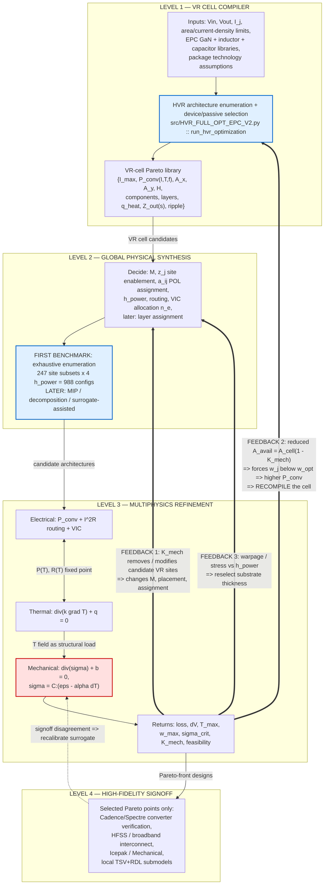

# Novelty Boundary and Minimum ETM Experiment for DVPD

**Status:** audit + formulation only. No source code was modified in producing this document.
**Date:** 2026-09-02
**Scope:** freeze the novelty boundary against primary sources; specify the smallest experiment
that can *falsify* the proposed electro-thermo-mechanical (ETM) thesis.

### Source-verification status

| Source | Access achieved | Depth |
|---|---|---|
| June-2026 DVPD, [arXiv:2606.28837](https://arxiv.org/abs/2606.28837) | Full text (HTML v1) | Methods, tables, results extracted |
| STAMP-2.5D, [arXiv:2504.21140](https://arxiv.org/abs/2504.21140) / [ICCD'25 DOI](https://doi.org/10.1109/ICCD65941.2025.00029) | Full text (HTML v2) | Methods, materials, SA cost function extracted |
| ATMPlace, [arXiv:2511.17319](https://arxiv.org/abs/2511.17319) | Full text (HTML v1) | Compact models, objective, variables extracted |
| ISCAS 2024, [DOI 10.1109/ISCAS58744.2024.10558456](https://doi.org/10.1109/ISCAS58744.2024.10558456) | **Not retrieved** — IEEE paywall; web search disabled by org policy | Characterized only via `deep-research-report_HVR.md` |
| ECTC 2024, [DOI 10.1109/ECTC51529.2024.00364](https://doi.org/10.1109/ECTC51529.2024.00364) | **Not retrieved** — same | Characterized only via `deep-research-report_HVR.md` |

**OPEN DECISION:** ISCAS'24 and ECTC'24 must be read in full before submission. They are treated
here as *occupied territory* on the strength of the internal report plus the June-2026 paper's own
positioning, not on verified primary reading. **REVIEWER RISK:** if either paper already contains a
mechanical constraint, the novelty boundary shifts materially. Resolve in Action 1.

---

## Executive Summary

**What June-2026 already does.** [arXiv:2606.28837](https://arxiv.org/abs/2606.28837)
(Krishnakumar, Popryho, Choi, Rahimzadeh Khorasani, Swaminathan, Kumar, Partin-Vaisband) is an
end-to-end DVPD synthesis framework and it is *from this lab*. It enumerates the distributed VR
count **M** and picks the minimizer of total modeled system loss (M=70 for its 1 kW / 500 mm²
case); it analytically optimizes switch width by solving ∂P/∂w = 0; it sets f_sw to the minimum
feasible value satisfying ripple; it derives modular inductor count as N_L = ⌈I_φ/I_L0⌉; it builds
an m×n VR cell array with cell dimensions from component extents; it sizes vertical-interconnect
(VIC) counts per layer from per-via current limits; and it reports 84 % end-to-end efficiency at
54 % area utilization for 48 V→1 V, 87.6 % at 75 %, over a 1–50 kW sweep, with IR drop < 2.7 % and
L·di/dt droop < 9 %. It is thermally *interfaced* — an external electrothermal loop iterates
temperature-dependent losses against microchannel cooling to a converged 84 °C at 1.6 g/s.
**There is no structural mechanics anywhere in it.**

Three of its stated modelling conditions are the seams this project can open, and all three are the
paper's own words: current is allocated to VRs *by proximity*, not by an optimized assignment;
each VR is assumed to deliver ≈1/M of load current from *locally similar* cells in a regular
array; and "intra-VR routing is not constrained by local blockages, keep-out regions, or package
design-rule limitations." A mechanical keep-out mask is precisely a local blockage. The baseline
assumes away the object this paper would introduce.

**What STAMP-2.5D and ATMPlace already do.** Both place **chiplets** — fixed-size, fixed-power
blocks — and neither models power delivery at all.
[STAMP-2.5D](https://arxiv.org/abs/2504.21140) runs ANSYS Mechanical (≈40 k elements) inside a
simulated-annealing loop over chiplet position and orientation, optimizing a weighted sum of
wirelength, peak temperature, and **von Mises stress** under operational thermal load plus
self-weight gravity; chiplet thickness (150 µm) and interposer thickness (100 µm) are *fixed*,
no stress-free reference temperature is declared, no warpage is reported as an output, and power
enters only as a per-chiplet heat flux. [ATMPlace](https://arxiv.org/abs/2511.17319) is an
analytical gradient placer over chiplet (x, y, θ) that co-optimizes wirelength, peak temperature
and **operational warpage** via a Green's-function thermal model and a fitted biharmonic-plate
warpage surrogate (MAE 2.52 µm, >10 000× speedup); it computes **no stress field at all**, treats
assembly/residual stress only through a fitted T_ref and bias constant, freezes the stack-up, and
states that power, ground and I/O nets are "handled later."

So the two literature families are disjoint in a specific, exploitable way: **A optimizes the
power-delivery architecture with no mechanics; B optimizes mechanics over blocks whose count,
size, and dissipation are immutable inputs.**

**What may still be novel.** In chiplet placement the heat sources are *given*. In DVPD synthesis
the heat sources are *synthesized*: M, each cell's footprint, and each cell's dissipation are
coupled outputs of the converter physics through I_j → w_FET^opt → P_conv,j → A_j. Mechanics
therefore cannot merely *relocate* blocks — it can change how many converters exist, how large and
how hot each one is, and (through the baseline's own per-layer area-budget relation
w_LS^max = A_budget /(M · max{l_ind, l_LS})) it can force a switch off its analytic loss optimum.
That is a mechanical→converter-electrical feedback path with no counterpart in either family.

**Central hypothesis.**
- **H0:** adding explicit mechanical constraints to a properly electrothermally optimized DVPD
  synthesis does not materially change the feasible architecture set, the selected architecture,
  or the electrical Pareto ranking.
- **H1:** explicit mechanical constraints materially alter at least one DVPD architectural
  decision — M, placement, cell sizing, POL assignment, VIC allocation, layer assignment, routing,
  or substrate thickness — and expose one or more attractive E/ET optima as mechanically infeasible.

**Biggest reviewer risk.** Not "is this novel?" but **"is this just the June-2026 optimizer with
ANSYS bolted on the back?"** The entire experiment must be designed so that the mechanical result
*re-enters* the synthesis and changes a power-delivery variable. If the deliverable can be
reproduced by running June's floorplan through a STAMP-style post-check, there is no paper.
The second-biggest risk is that the ETM effect is an artifact of an assumed σ_allow or an
unrealistic mechanical boundary condition — hence the mandatory threshold and BC sweeps below.

**Immediate go/no-go experiment.** A 24×24 mm power-delivery region, 4 POLs (segmented into 16
sub-POLs) at 240 A total, 8 candidate VR sites, h_sub ∈ {200, 300, 400, 500} µm — **988
exhaustively enumerable ETM configurations** (247 site subsets × 4 thicknesses) under nearest-VR
assignment. Run E, then ET, then ETM on the *same* candidate set and ask whether the ET optimum
survives mechanics. Estimated critical path is the mechanical oracle, and that lift is smaller
than expected: a working PyAEDT HFSS↔Mechanical **steady-state thermal** harness with
homogenized-vs-explicit-geometry comparison already exists in the TSV project
(`tessera-master_2/revision/coupled_electrothermal_hfss_mechanical.py`), but it contains **no
Static Structural step, no E/ν/CTE assignment, and no warpage or stress extraction**.

---

## Reproduced June-2026 DVPD Formulation

### Source-faithful narrative

The framework takes a load specification (power, V_out, current density, footprint) and a
technology stack (GaN switch parameters, unit-inductor and capacitor libraries, interconnect
geometry per tier), and produces a distributed array of substrate-embedded hybrid VR cells that
minimizes total system-wide power loss from platform input to delivered on-chip load power.

Its logic is essentially *analytic-then-enumerate*. For a trial VR count M, per-VR current is
I/M; per-BRANCH current follows (I_cell*B_i/N -- Phase 0N-R: NOT 'per-phase'; the buck stage has two switching phases and K parallel branches); the modular inductor count is the ceiling ratio of branch current
to unit-inductor rating; minimum feasible switching frequency follows from the ripple budget;
optimal switch width follows in closed form from ∂P/∂w = 0; the cell footprint follows from the
largest component extent; and if the analytic switch width exceeds what the per-layer area budget
allows per cell, the switch is *resized down to fit* — trading conduction loss for feasibility.
Loss is then summed across conversion, intra-VR routing, VIC, and VR-to-POL routing, and M is
swept over feasible integers to find the minimizer. Vertical interconnect counts are sized from
connection current against a per-via current limit. Thermal behaviour is evaluated by an external
coupled electrothermal solver, not optimized within the loop.

Two structural properties matter enormously for this project. First, the VR array is **regular**:
locally similar cells, aspect ratio ≈1, each delivering ≈1/M of the load. Second, POL-to-VR
current allocation is **emergent from proximity**, not a decision variable.

### A. System inputs

| Input | Value / form in source | Label |
|---|---|---|
| Load power | 1 kW reference; 1–50 kW sweep | [PAPER-EXPLICIT] |
| Output voltage | 1 V POL | [PAPER-EXPLICIT] |
| Input voltage | 48 V / 24 V / 12 V (architectures A1/A2/A3) | [PAPER-EXPLICIT] |
| Current density target | 2 A/mm² (roadmap 2–4 A/mm²) | [PAPER-EXPLICIT] |
| Load footprint | 500 mm² | [PAPER-EXPLICIT] |
| POL segmentation | load divided into 100 POL segments | [PAPER-EXPLICIT] |
| Converter topology | DSCH as "demonstration vehicle"; framework claimed topology-agnostic | [PAPER-EXPLICIT] |
| Front-end converter efficiency | ~98 % transformer-based | [PAPER-EXPLICIT] |
| GaN switch parameters | V_gs=5 V, µC_AlGaN=67.4 A/V², l_sw=1 mm, C_iss0=220 pF/mm², C_oss0=150 pF/mm², I_g=2.4 A | [PAPER-EXPLICIT] |
| Inductor library | Table II: L, L□ (nH/mm²), I_sat, I□, R_ESR, µ_r across PCB/coax/toroid/spiral/solenoid/TSV/array; target 77 nH/mm², 5 A, 11 mΩ | [PAPER-EXPLICIT] |
| Capacitor library | flying caps 8–32 V stress, 1–2 µF/mm²; 2 × 3.2 µF per cell; deep-trench decap ≥100 fF/µm² | [PAPER-EXPLICIT] |
| Interconnect geometry | Table III per tier: BGA solder 400/300/800 µm → 0.3 mΩ; TSV Cu 30/300/60 µm → 7.1 mΩ; chiplet pad Cu 10/10/20 µm → 1.7 mΩ | [PAPER-EXPLICIT] |
| Resistivities | solder 130 nΩ·m, Cu 17 nΩ·m | [PAPER-EXPLICIT] |
| Ripple budget | allowable ripple ratio γ; 2 % output ripple for cap sizing | [PAPER-EXPLICIT] |
| Power-layer assignment | HS GaN flip-chip bottom RDL, LS bottom, flying caps middle, inductors top near POLs | [PAPER-EXPLICIT] |
| Cooling | substrate-embedded microchannels adjacent to GaN layer, 1.6 g/s coolant | [PAPER-EXPLICIT] |
| Allowable temperature | hotspots flagged >100 °C; 84 °C achieved | [PAPER-EXPLICIT] |
| Per-via current limit | used to size parallel VIC counts (numeric value not recovered from HTML) | [PAPER-EXPLICIT] / value **OPEN DECISION** |
| Mechanical properties (E, ν, CTE) | — | **[NOT PRESENT]** |
| Stress-free / assembly reference temperature | — | **[NOT PRESENT]** |
| Substrate thickness as an input to be varied | TSV height fixed 300 µm; sensitivity only via TSV resistance ×1.5, pitch ×1.5 | [PAPER-EXPLICIT] as fixed; **[NOT PRESENT]** as design variable |

### B. Decision variables

| Variable | Classification in June-2026 | Evidence |
|---|---|---|
| Number of VRs **M** | **ENUMERATED / SWEPT** — "obtained by numerically minimizing the total modeled VR-system loss over feasible integer values of M"; M=70 called "a design-point-specific output" | [PAPER-EXPLICIT] |
| Switching frequency f_sw | **DERIVED** — set to minimum feasible from ripple, f_sw^min ∝ ΔV_L/(γ I_L0 L_0); "the optimal operating point naturally occurs near the minimum feasible switching frequency" | [PAPER-EXPLICIT] |
| Switch width w | **EXPLICIT OPTIMIZATION VARIABLE (analytic)** — ∂P/∂w = 0, w_FET^opt ∝ (I_ds/V_ds)·f_sw^(−1/2) | [PAPER-EXPLICIT] |
| Modular inductor count N_L | **DERIVED** — N_L = ⌈I_φ/I_L0⌉, L_φ = L_0/N_L | [PAPER-EXPLICIT] |
| m×n floorplan array | **DERIVED** — rows from max{l_ind, l_LS}; cell width from Eq. (4) | [PAPER-EXPLICIT] |
| VR cell footprint | **DERIVED** — max{l_ind, l_LS} · w_LS^max, components vertically aligned in one cell | [PAPER-EXPLICIT] |
| Switch sizing factor w_LS^opt/w_LS^max | **DERIVED** — independent of M, governed by input voltage (crossover ≈30 V) | [PAPER-EXPLICIT] |
| VIC counts per layer | **DERIVED** from connection current ÷ per-via limit; e.g. A1: 132 BGAs, 30 202 / 27 845 / 14 148 TSVs, 200 000 pads | [PAPER-EXPLICIT] |
| x–y VR distribution | **HEURISTIC RULE** — balanced cells, aspect ratio ≈1, array aspect matched to load footprint | [PAPER-EXPLICIT] |
| POL-to-VR current allocation | **HEURISTIC RULE** — "current is primarily supplied by nearby VRs"; *not* an optimization variable | [PAPER-EXPLICIT] |
| Vertical stacking / power-layer allocation | **HEURISTIC RULE** — from component count/size and packaging limits | [PAPER-EXPLICIT] |
| Conversion architecture (A1/A2/A3) | **ENUMERATED** — three multi-stage schemes compared | [PAPER-EXPLICIT] |
| Component selection from library | **DERIVED** — unit inductor target row adopted | [PAPER-EXPLICIT] |
| RDL trace dimensions | **FIXED INPUT** — process-dependent; separate layers for intra- vs inter-VR routing | [PAPER-EXPLICIT] |
| Substrate / power-layer thickness | **FIXED INPUT** (300 µm TSV height) | [PAPER-EXPLICIT] |
| Arbitrary (non-array) VR placement | — | **[NOT PRESENT]** |
| Explicit POL→VR assignment variable | — | **[NOT PRESENT]** |
| Mechanical keep-out | explicitly assumed **absent** | **[NOT PRESENT]** |

### C. Derived quantities

Per-VR current I/M; per-BRANCH current I_b = I_cell*B_i/N (Phase 0N-R correction); summed output ripple Δi_φ; minimum f_sw; converter losses
(switch conduction ∝1/w, switching ∝ w·f_sw — ">70 % of conversion losses originate from power
switches"); inductor R_ESR and core loss; flying-capacitor loss; intra-VR routing loss scaling as
M·(R_PDN/M)·(I/M)² ∝ 1/M²; inter-VR / VR-to-POL RDL loss (corner POLs ≈2× central); VIC loss
(3.71 W nominal); supply-to-VR distribution loss increasing linearly with system power; area
utilization; IR drop; transient droop; efficiency; junction temperature. Input RMS current scales
as I_in,rms ∝ I_out√(V_out/V_in). [PAPER-EXPLICIT]

### D. Objectives

**Optimization objective:** minimize total system-wide power loss subject to footprint,
power-density and ripple constraints — equivalently maximize end-to-end efficiency across a
unified boundary from platform input power to delivered on-chip load power. The claim that the
preferred VR count is obtained by minimizing total modeled VR-system loss after re-optimizing
converter and package parameters is **confirmed** in the source. [PAPER-EXPLICIT]

**Evaluated-only metrics:** IR drop, transient droop, area utilization, current density, junction
temperature, per-component and spatial loss maps. [PAPER-EXPLICIT]

### E. Constraints

Ripple ratio γ; footprint containment (power delivery must fit within the load footprint);
per-layer area budget w_LS^max = A_budget/(M·max{l_ind,l_LS}) with mandatory switch resize if
w_LS^opt exceeds it; inductor saturation at I_L0 per unit inductor (below one unit, ripple met by
raising f_sw instead); per-via current limit and available in-package VIC area; layer count bounded
by packaging capability; thermal feasibility (>100 °C hotspots flagged); and the stated routing
conditions — locally similar cells, routing width ≈ independent of M, each VR delivers ≈1/M of
load current, and **no local blockages, keep-out regions, or design-rule limits on intra-VR
routing**. A2/A3 hit a practical ceiling requiring ≈75 % of load-die area for VICs and routing.
[PAPER-EXPLICIT]

### F. Outputs

Optimal M; switch width and sizing factor; N_L per phase; f_sw; m×n array and cell footprint;
per-layer VIC counts; bottleneck-layer identification (configuration-dependent); area utilization;
end-to-end efficiency (A1 84 % @54 % area; A2 86 %; A3 87.6 % @~75 %); conversion loss 13.88 % at
l_sw = 1.0 mm (10.87 % / 18.68 % at 0.5 / 1.8 mm); isothermal 185 W (84.6 %), unmanaged 225 W
(81.6 %), cooled steady-state 210 W (82.6 %); loss maps; IR drop < 2.7 %; droop < 9 % (→ ~6–7 %
with edge decaps); converged junction temperature. [PAPER-EXPLICIT]

### Reconstructed mathematical formulation

**RECONSTRUCTED — the June-2026 paper does not present its framework as this single program.**
The symbols z_j and a_ij below are *our* notation. The paper has no site-enablement binary and no
assignment variable; its VR array is regular and its current allocation is proximity-based. This
formulation is written so that the baseline is the special case obtained by fixing z to a regular
m×n lattice and fixing a to nearest-VR.

Sets: POL segments i ∈ 𝓘, candidate VR sites j ∈ 𝓙, package tiers ℓ ∈ 𝓛.

    minimize   P_total(x)
      x

    P_total = Σ_j P_conv,j(I_j, w_j, f_sw,j, τ_j)          [conversion]
            + Σ_j P_intraVR,j(M)                            [intra-VR routing, ∝ 1/M²]
            + P_VIC(n_via, I)                               [vertical interconnect]
            + Σ_{i,j} P_route,ij(a_ij, d_ij)                [VR-to-POL RDL]
            + P_supply(P_sys)                               [supply-to-VR distribution]

    subject to
      M = Σ_j z_j                                            [RECONSTRUCTED]
      Σ_j a_ij = 1,  a_ij ≤ z_j,  a_ij ∈ {0,1}              [RECONSTRUCTED]
      I_j = Σ_i a_ij I_i                                     [RECONSTRUCTED]
      Δi_φ,j = γ I_φ,j ≤ γ_max                               [PAPER-EXPLICIT]
      N_L,j = ⌈I_φ,j / I_L0⌉                                 [PAPER-EXPLICIT]
      f_sw,j ≥ f_sw^min(ΔV_L, γ, I_L0, L_0)                  [PAPER-EXPLICIT]
      w_j = min( w_j^opt(∂P/∂w = 0), w_LS^max )              [PAPER-EXPLICIT]
      w_LS^max = A_budget,ℓ / (M · max{l_ind, l_LS})         [PAPER-EXPLICIT]
      Σ_j A_cell,j ≤ A_load                                  [PAPER-EXPLICIT]
      I_φ,j ≤ I_sat                                          [PAPER-EXPLICIT]
      n_via,e ≥ I_e / I_via^max                              [PAPER-EXPLICIT]
      T_max ≤ T_allow          (external coupled solver)     [PAPER-EXPLICIT, evaluated]
      h_sub = 300 µm                                          [PAPER-EXPLICIT, fixed]

The chain by which each variable reaches the objective: **M** sets I_j = I/M, hence
w^opt ∝ 1/M and per-VR switch loss ∝ 1/M (total switch loss ≈ constant for fixed system power),
while intra-VR routing loss falls as 1/M² and VIC/cell-overhead terms grow with M — producing the
interior optimum at M=70. **f_sw** trades ripple-driven passive size against w·f_sw switching loss.
**w** trades ∝1/w conduction against ∝w·f_sw switching, with the per-layer area budget capping it.
**Floorplan and assignment** set d_ij and hence Σ I²R routing loss. **VIC allocation** sets the
vertical I²R term against consumed in-package area.

**PUBLICATION CRITICAL:** the proposed work must state this reconstruction explicitly as a
reconstruction. Attributing z_j / a_ij to the June authors would be a factual misrepresentation of
a paper by our own colleagues and is the fastest possible route to a hostile review.

---

### Current Code Support Audit

Repository audited: `Scalable_Integrated_VR/` (19 flat modules in `src/`, no `tests/`,
`examples/`, `scripts/`, or `config/` directories; no `requirements.txt`, `pyproject.toml`, or
`setup.py`). Also audited: `tessera-master_2/` (TSV framework, separate repository, not importable
from this project).

Status assigned strictly on *found executable code*, never on what a publication claims.

#### Converter / VR-cell layer

| Capability | Req. by June baseline? | Status | Evidence in code | Current I/O | Missing piece | Immediate action |
|---|---|---|---|---|---|---|
| Architecture enumeration (N, K, K_A, B) | Yes | **SUPPORTED** | `src/HVR_FULL_OPT_EPC_V2.py :: generate_architectures(...)`, `:: VRArchitecture` | in: component-count budget; out: list of `VRArchitecture` | — | reuse as-is |
| Discrete GaN device selection | Yes | **SUPPORTED** | `src/HVR_FULL_OPT_EPC_V2.py :: load_epc_devices(...)`, `:: filter_candidate_devices(...)` | in: `EPC-Product-Table.csv` (97 parts, 90 usable); out: `EPCDevice` | — | reuse as-is |
| Analytic switch-width sizing (∂P/∂w = 0) | Yes | **PARTIAL** | `src/HVR_FULL_OPT_sizing.py` sweeps W_H/W_L numerically (R_on ∝ 1/W, parasitics ∝ W) | in: width grid; out: best-loss width | no closed-form ∂P/∂w=0; no `w_LS^max` area-budget clamp as in June Eq. for cell width | add analytic optimum + area clamp to match baseline |
| f_sw optimization | Yes | **SUPPORTED** | `src/HVR_FULL_OPT_EPC_V2.py :: run_hvr_optimization(...)`, 50 log-spaced points 43 kHz–200 MHz | out: `optimized_f_sw` | baseline sets f_sw to *minimum feasible*; ours searches a grid — different policy, not a gap | document the difference |
| Loss breakdown | Yes | **SUPPORTED** | `:: LossResult` — `total_loss, p_cond, p_sw, p_sw_hs, p_sw_gd, p_sw_coss` | out: 5-way breakdown (W) | no inductor-core / cap-loss split exposed at result level | expose remaining terms |
| Ripple constraint ΔI, ΔV | Yes | **SUPPORTED** | `:: LossResult.delta_i_out`, `.delta_v_out`, `.coupling_boost`; gates in `:: optimize_architecture(...)` | out: ripple + feasibility flag | — | reuse |
| Inductor saturation / unit-inductor modularity | Yes | **PARTIAL** | `:: Inductor.i_sat_a`, `:: filter_candidate_inductors(...)` | filters by I_sat | no N_L = ⌈I_φ/I_L0⌉ modular-array construction | add modular allocation |
| **Scalar cell area** | Yes | **SUPPORTED** | `:: _compute_area(...)` returns `max(N·fp_hs, K·fp_ls, K·fp_ind, (N−1)·fp_cap)` | out: one float, mm² | — | — |
| **Physical footprint A_x × A_y** | Yes (June derives cell width and m×n rows) | **UNSUPPORTED** | `_compute_area` returns a scalar `max(...)`; no width/length anywhere | — | A_x, A_y, aspect ratio, orientation | **VR-cell-compiler task #1** |
| **Component height H / stack height** | Yes | **PARTIAL** | `:: Inductor.height_um` **exists and is populated**; `:: EPCDevice` has `footprint_mm2` only — **no height field** | inductor height available but never propagated into `_compute_area` | switch/cap heights; per-tier stack height roll-up | add height to `EPCDevice`; propagate |
| **Per-component rectangles** | Yes (implicitly, via cell construction) | **UNSUPPORTED** | none found | — | component-level (x, y, w, l) within the cell | VR-cell-compiler task #2 |
| **Layer / tier assignment** | Yes (June fixes HS/LS bottom, caps middle, inductors top) | **UNSUPPORTED** | no layer field in any dataclass | — | per-component tier index | VR-cell-compiler task #3 |
| **Spatial heat map q_heat(x,y,z)** | No (June uses external solver) — **yes for ETM** | **UNSUPPORTED** | loss is scalar per mechanism, never localized | — | component-resolved heat-source coordinates | VR-cell-compiler task #4 |
| **I_max per cell** | Yes | **PARTIAL** | device `ID_A` and `Inductor.i_sat_a` exist in filtering; not surfaced on `OptimizationResult` | — | explicit `I_max` output field | trivial: expose |
| **Z_out(s) / dynamic model** | No | **UNSUPPORTED** | none found | — | small-signal output impedance | defer past first experiment |
| **Temperature dependence P_conv(I, T, f)** | Yes (June's external loop needs it) | **UNSUPPORTED** | `LossModelInputs` has no temperature field; no R_on(T), no R_ESR(T) | — | T as a first-class model input | **blocking for ET stage** |
| Transient response | No | **UNSUPPORTED** | `Framework_cowork_physical (1).py :: estimate_droop_mv(...)` is a lumped algebraic droop estimate only | — | — | out of scope for first experiment |

#### Routing / PDN layer

| Capability | Req. by June baseline? | Status | Evidence in code | Current I/O | Missing piece | Immediate action |
|---|---|---|---|---|---|---|
| Manhattan VR→POL distance | Yes | **SUPPORTED** | `src/Framework_w_HVR_OPT_sizing_v2.py :: DVPDRoutingModel.compute_ppdn_loss(...)` | out: distance matrix, R_eff, loss | — | reuse |
| Parallel-conductance PDN (R_eff = 1/Σ 1/R_ij) | Yes | **SUPPORTED** | same function | out: per-POL effective resistance | this *implicitly* shares every POL across every VR — it is **not** an explicit assignment | see next row |
| **Explicit POL→VR assignment a_ij** | No (June is proximity-heuristic) | **UNSUPPORTED** | conductance weighting only; no binary/fractional assignment variable | — | a_ij as a decision variable | E-level enumerator task |
| DC resistance | Yes | **PARTIAL** | `DieConfig.rho_mohm_per_mm = 50` — a lumped assumed constant | — | not derived from trace width/thickness/sheet resistance | derive from RDL geometry |
| **Temperature-dependent resistance R(T)** | Yes | **UNSUPPORTED** | no ρ(T) anywhere in `src/` | — | ρ_Cu(T) = ρ₀[1+α(T−T₀)] | **blocking for ET stage** |
| Skin/frequency effect | Partly | **PARTIAL** | `rho_ac = rho_dc · sqrt(f_sw/f_ref)` in `compute_ppdn_loss(...)` | out: `rho_ac_mohm_per_mm` | a √f surrogate, not a validated broadband model | acceptable for first experiment; document |
| **Vertical interconnect from geometry** | Yes | **UNSUPPORTED** | `compute_ppdn_loss(..., r_bump_ohm=0.08e-3, r_tsv_ohm=0.04e-3)` — **hard-coded scalar defaults** | — | no d_TSV, no h, no N_via, no pitch, no ρ(T) | **blocking: h_sub cannot currently be a design variable at all** |
| **VIC count sizing from current limit** | Yes | **UNSUPPORTED** | none found | — | n_via ≥ I/I_via^max | E-level enumerator task |
| Arbitrary candidate-site placement | No (June uses a regular array) | **PARTIAL** | `:: place_vrs_A1(...)` generates a hard-coded periphery ring; A2 under-die variant in `Framework_cowork*.py` | in: n_vr; out: fixed pattern | no free/enumerable candidate-site list | E-level enumerator task |
| Broadband RLCG / S-parameters | No | **UNSUPPORTED** *in this repo* | exists only in `tessera-master_2/` (separate repo, not importable) | — | — | deliberately out of scope |
| Per-net loss / route generation | Yes | **UNSUPPORTED** | aggregate PPDN loss only | — | — | not needed for first experiment |

#### Thermal layer

| Capability | Req. by June baseline? | Status | Evidence in code | Current I/O | Missing piece | Immediate action |
|---|---|---|---|---|---|---|
| Lumped temperature rise | Yes | **PARTIAL** | `src/Framework_cowork_physical (1).py :: CompactPhysicalModel.estimate_thermal_rise(...)` — `R_th = 0.35 + 1.8/√A_cm2`, sharing factor `0.85+0.15√n_vr` | in: ambient, total loss, n_vr, footprint; out: one temperature | an empirical spreading-resistance fit; **no spatial field, no conduction solve, no material k** | replace for ET stage |
| Steady-state field T(x,y,z) | Yes | **UNSUPPORTED** *in this repo* | none | — | — | use ANSYS harness (below) or compact FV model |
| Two-way electrothermal iteration | Yes | **UNSUPPORTED** *in this repo* | no P(T) coupling exists because no P(T) exists | — | — | **blocking for ET stage** |
| **ANSYS steady-state thermal automation** | — | **SUPPORTED** *(separate repo)* | `tessera-master_2/revision/coupled_electrothermal_hfss_mechanical.py` (1456 lines) — PyAEDT `from ansys.aedt.core import Desktop, Hfss, Mechanical`; converged HFSS↔Mechanical loop with TOL_T/TOL_S, per-object EM-loss mapping, per-TSV temperature extraction | in: geometry CSV; out: converged T, S | TSV-array geometry only; not a package-stack builder | **reuse as the oracle driver** |
| Homogenized vs explicit-geometry two-fidelity precedent | — | **SUPPORTED** *(separate repo)* | `tessera-master_2/FEM/HFSS_RUN_SINGLE_LINE_THERMAL_MECH_REGION_v2.py` (2091 lines) — builds both full-geometry and homogenized-ETC Mechanical designs and compares runtime/accuracy | out: JSON summary, ETCs, P_diss | thermal ETC only; no mechanical homogenization | direct template for the mechanical two-fidelity strategy |

#### Mechanical layer

| Capability | Req. by June baseline? | Status | Evidence in code | Current I/O | Missing piece | Immediate action |
|---|---|---|---|---|---|---|
| Static Structural solve | No | **UNSUPPORTED** | grep for `warpage\|von_mises\|static_structural\|CTE` across `src/` and `tessera-master_2/*.py` returns **zero hits** | — | entire structural analysis | **build — critical path** |
| Structural material properties (E, ν, CTE, ρ) | No | **UNSUPPORTED** | no E/ν/CTE anywhere in either repo | — | material card set | Action 8 |
| Warpage w_max | No | **UNSUPPORTED** | none | — | — | Action 8 |
| Local stress (σ_vm / σ₁ / interface) | No | **UNSUPPORTED** | none | — | — | Action 8 |
| Assembly / cure residual stress | No | **UNSUPPORTED** | none | — | — | M1 tier; **OPEN DECISION** |
| Mechanical keep-out mask | No | **UNSUPPORTED** | none | — | — | Action 8 |
| Mechanical surrogate | No | **UNSUPPORTED** | none | — | — | deliberately deferred until FEA reference exists |

#### Audit summary — the four blocking gaps

1. **No temperature anywhere in the electrical models.** Neither `LossModelInputs` nor
   `DVPDRoutingModel` accepts T. The ET stage cannot be run at all until P_conv(I,T) and R(T)
   exist. This is the single most under-appreciated gap, because the internal report describes the
   lab as having "an existing electrothermal loop" — it does, but in the **TSV repository**, not in
   this one, and it is coupled to TSV geometry rather than to converter cells.
2. **No geometry, only scalar area.** `_compute_area` returns `max(...)` of four component-area
   terms — a 3D-stacked idealization that discards A_x, A_y, H, orientation, and layer. Mechanics
   cannot act on a scalar. **A = 20 mm² does not support physical synthesis.**
3. **Vertical interconnect is two hard-coded floats** (`r_bump_ohm=0.08e-3`, `r_tsv_ohm=0.04e-3`).
   There is no TSV diameter, height, pitch, or count. Therefore **h_sub — the proposed
   cross-domain design variable — has literally no path into the present electrical model.**
   Without fixing this, the substrate-thickness go/no-go test cannot run.
4. **No mechanics of any kind, in either repository.** But the ANSYS *driver* problem is largely
   solved: a mature PyAEDT harness with convergence control, EM-loss mapping, result extraction,
   and an explicit homogenized-vs-full-geometry comparison already exists. The work is adding a
   Static Structural system and structural materials to a working automation stack, not building
   one from nothing.

**OPEN DECISION:** the existing harness drives **AEDT Mechanical**, whose structural capability is
narrower than Workbench/MAPDL (which is what STAMP-2.5D used). Decide before Action 8 whether to
(a) extend the AEDT harness and accept its structural limits, or (b) build a PyMAPDL/Workbench
path and reuse only the geometry/material/BC patterns. Recommendation: prototype (a) first because
the thermal half already works end-to-end; escalate to (b) if warpage extraction or layered-shell
behaviour proves inadequate.

---

## Novelty Matrix

Markers: **YES** / **PARTIAL** / **NO** / **QUAL** (qualitative only) / **PROP** (proposed, not yet
implemented) / **OPEN** (open decision).
Column B is split wherever STAMP-2.5D and ATMPlace differ.

### System / power delivery

| Feature | A: June-2026 DVPD | B: STAMP-2.5D / ATMPlace | C: Proposed ETM DVPD | Evidence |
|---|---|---|---|---|
| Distributed VR count M | **YES** — enumerated, M=70 | **NO** / **NO** — no VRs modeled | **PROP** — M as a mechanically constrained variable | [A](https://arxiv.org/abs/2606.28837); [B1](https://arxiv.org/abs/2504.21140); [B2](https://arxiv.org/abs/2511.17319) |
| VR sizing (footprint from converter physics) | **YES** — cell from max{l_ind,l_LS}·w_LS^max | **NO** / **NO** — chiplet sizes are fixed inputs | **PROP** | A §floorplan; B1 §V (150 µm fixed) |
| VR x–y placement | **PARTIAL** — regular m×n array, aspect ≈1 | **NO** / **NO** (they place chiplets, not VRs) | **PROP** — arbitrary candidate sites | A; B1 SA over chiplet pos.; B2 CGD over (x,y,θ) |
| POL segmentation | **YES** — 100 segments | **NO** / **NO** | **PROP** — 16 sub-POLs in benchmark | A |
| POL-to-VR assignment | **NO** — proximity heuristic, not a variable | **NO** / **NO** | **PROP** — explicit a_ij | A ("current is primarily supplied by nearby VRs") |
| Multiple VRs sharing one POL | **PARTIAL** — implicit in proximity sharing | **NO** / **NO** | **PROP** — fractional a_ij (deferred past first benchmark) | A |
| Converter topology | **YES** — DSCH, A1/A2/A3 enumerated | **NO** / **NO** | **PROP** — inherited from our HVR engine | A; `src/HVR_FULL_OPT_EPC_V2.py` |
| Switching frequency | **YES** — min feasible from ripple | **NO** / **NO** | **PROP** | A |
| Switch sizing | **YES** — analytic ∂P/∂w=0 + area clamp | **NO** / **NO** | **PROP** — with mechanically reduced area budget | A |
| Passive sizing | **YES** — library + ripple | **NO** / **NO** | **PROP** | A Table II |
| Modular inductor allocation | **YES** — N_L=⌈I_φ/I_L0⌉ | **NO** / **NO** | **PROP** | A |
| Current density | **YES** — 2 A/mm² target | **NO** / **NO** | **PROP** | A |
| Power density | **YES** — 1–50 kW sweep | **NO** / **NO** — fixed per-chiplet TDP | **PROP** — 240 W benchmark, kW later | A; B1 §IV-C |

### Physical design

| Feature | A: June-2026 DVPD | B: STAMP-2.5D / ATMPlace | C: Proposed ETM DVPD | Evidence |
|---|---|---|---|---|
| Real component dimensions | **YES** — l_ind, l_LS, w_LS drive the cell | **NO** / **NO** — chiplets are given rectangles | **PROP** | A |
| VR footprint A_x × A_y | **YES** | **NO** / **NO** | **PROP** (our code: **UNSUPPORTED** today) | A; audit above |
| Aspect ratio | **YES** — balanced cells, ≈1 | **NO** / **NO** | **PROP** | A |
| Component orientation | **NO** | **YES** / **YES** — both optimize chiplet θ | **PROP** — cell orientation | B1 "perturbs positions or orientations"; B2 θ∈{0,90,180,270} |
| Vertical stacking | **PARTIAL** — heuristic from component count/packaging limits | **NO** / **NO** — stack frozen | **PROP** — mechanically constrained tier assignment | A; B2 "stack-up is frozen" |
| Layer assignment | **PARTIAL** — fixed rule (HS/LS bottom, caps mid, L top) | **NO** / **NO** | **PROP** | A |
| Physical overlap constraints | **PARTIAL** — cell packing only | **YES** / **YES** — density/legalization | **PROP** | B1; B2 MILP legalization |
| Placement legalization | **NO** | **YES** (MILP) / **YES** (MILP, Gurobi) | **PROP** — deferred | B1; B2 |
| Package footprint | **YES** — 500 mm² containment | **YES** / **YES** — fixed interposer 45×45 / 50×50 mm | **PROP** | A; B1 |
| **Substrate / interposer thickness as a design variable** | **NO** — fixed 300 µm, sensitivity sweep only | **NO** / **NO** — 100 µm interposer, 150 µm die, both fixed | **PROP** — h_power as the cross-domain variable | A Table III; B1 §V; B2 §4 |

### Interconnect / PDN

| Feature | A: June-2026 DVPD | B: STAMP-2.5D / ATMPlace | C: Proposed ETM DVPD | Evidence |
|---|---|---|---|---|
| RDL routing | **YES** — separate intra/inter-VR layers | **NO** / **NO** — signal wirelength only | **PROP** | A; B2 ("power, ground and I/O handled later") |
| VR-to-POL routing loss | **YES** — corner POLs ≈2× central | **NO** / **NO** | **PROP** | A |
| Intra-VR routing loss | **YES** — ∝1/M² | **NO** / **NO** | **PROP** | A |
| Vertical interconnect count | **YES** — 30 202 / 27 845 / 14 148 TSVs | **NO** / **NO** | **PROP** | A Table III |
| TSV/BGA/pad allocation | **YES** — per-via current limit | **NO** / **NO** | **PROP** | A |
| Temperature-dependent resistance | **YES** — external electrothermal loop | **NO** / **NO** | **PROP** (our code: **UNSUPPORTED**) | A |
| Broadband RLCG | **NO** | **NO** / **NO** | **PROP** — signoff only, excluded from the loop | — |
| S-parameters | **NO** | **NO** / **NO** | **PROP** — signoff only | `tessera-master_2/` |
| Steady voltage drop | **YES** — <2.7 % | **NO** / **NO** | **PROP** | A |
| Transient droop | **YES** — <9 % evaluated | **NO** / **NO** | **PROP** — deferred | A |

### Thermal

| Feature | A: June-2026 DVPD | B: STAMP-2.5D / ATMPlace | C: Proposed ETM DVPD | Evidence |
|---|---|---|---|---|
| Component heat generation | **YES** — from converter loss model | **PARTIAL** / **PARTIAL** — fixed per-chiplet heat flux | **PROP** — loss *is* the heat source, and it is a decision outcome | A; B1 §IV-C; B2 (2×10⁵–3×10⁶ W/m²) |
| Spatial heat map | **YES** — spatial loss maps | **YES** / **YES** | **PROP** | A; B1; B2 |
| Steady-state temperature | **YES** — coupled solver, 84 °C | **YES** (FEA) / **YES** (Green's fn, MAE 2.43 °C) | **PROP** | A; B1; B2 Table V |
| Transient temperature | **NO** — steady-state | **NO** / **NO** | **PROP** — explicitly excluded from first experiment | A ("steady-state conditions") |
| Temperature-dependent electrical loss | **YES** | **NO** / **NO** | **PROP** | A |
| Two-way electrothermal iteration | **YES** — iterates to convergence | **NO** / **NO** — one-way P→T | **PROP** | A; B1 (static thermomechanical) |
| **Thermal constraint changes the optimized architecture** | **PARTIAL** — feasibility screen; loss rises 185→210 W when coupled | **YES** / **YES** — T is in the objective | **PROP** | A; B1 cost fn; B2 hinge penalty |

### Mechanical

| Feature | A: June-2026 DVPD | B: STAMP-2.5D / ATMPlace | C: Proposed ETM DVPD | Evidence |
|---|---|---|---|---|
| Explicit structural mechanics | **NO** | **YES** / **YES** | **PROP** | B1 ANSYS Mechanical; B2 plate surrogate |
| CTE mismatch | **NO** | **YES** / **YES** | **PROP** | B1 material table; B2 Eq. (2) |
| E / ν | **NO** | **PARTIAL** — E tabulated, **ν never given** / **PARTIAL** — homogenized effective E, ν | **PROP** | B1 Table (no ν, no density despite a gravity load); B2 §II-C |
| Package warpage | **NO** | **QUAL** — discussed, never computed / **YES** — the mechanical objective | **PROP** | B1 (warpage is narrative only); B2 (peak-to-valley w) |
| Local stress | **NO** | **YES** / **NO** — no stress field at all | **PROP** | B1 σ_vm; B2 "no von Mises/peel/shear metric" |
| von Mises stress | **NO** | **YES** — sole metric / **NO** | **PROP** — for Cu/RDL only | B1 |
| Max principal tensile stress (Si) | **NO** | **NO** / **NO** | **PROP** — correct brittle-material metric | — |
| Interface shear / peel | **NO** | **NO** / **NO** | **PROP** | B1 (µbump stress not computed) |
| Self-weight | **NO** | **YES** — 9.81 m/s² / **NO** | **OPEN** | B1 |
| **Assembly / cure residual stress** | **NO** | **NO** — acknowledged then excluded / **NO** — only a fitted T_ref and bias | **PROP** — M1 tier | B1 ("residual stresses … can modify absolute values", not modeled); B2 |
| Operational thermo-mechanical stress | **NO** | **YES** / **YES** | **PROP** — M0 tier | B1; B2 |
| Stress keep-out zone | **NO** — explicitly assumed absent | **NO** / **NO** | **PROP** — the core new object | A ("not constrained by … keep-out regions") |
| Mechanics changes **placement** | **NO** | **YES** / **YES** | **PROP** — but not novel on its own | B1; B2 |
| **Mechanics changes VR count** | **NO** | **NO** / **NO** — chiplet count is fixed input | **PROP** — *no counterpart in either family* | — |
| **Mechanics changes VR sizing** | **NO** | **NO** / **NO** — chiplet size fixed | **PROP** — *no counterpart* | — |
| **Mechanics changes substrate thickness** | **NO** | **NO** / **NO** — thickness fixed | **PROP** — *no counterpart* | A; B1; B2 |
| **Mechanics changes TSV/VIC allocation** | **NO** | **NO** / **NO** | **PROP** — *no counterpart* | — |
| **Mechanics changes POL→VR assignment** | **NO** | **NO** / **NO** | **PROP** — *no counterpart* | — |

### Optimization

| Feature | A: June-2026 DVPD | B: STAMP-2.5D / ATMPlace | C: Proposed ETM DVPD | Evidence |
|---|---|---|---|---|
| Exhaustive search | **PARTIAL** — integer sweep over M | **NO** / **PARTIAL** — SP-CP enumeration baseline ≤12 chiplets | **PROP** — full 988-config enumeration | A; B2 Table VI |
| MILP | **NO** | **YES** — wirelength MILP / **YES** — init + legalization | **PROP** — later scaling | B1; B2 |
| Simulated annealing | **NO** | **YES** / **NO** | **NO** | B1 (60–67 h/run) |
| Gradient placement | **NO** | **NO** / **YES** — CGD, Polak–Ribière | **NO** | B2 |
| Surrogate-assisted optimization | **NO** | **NO** — ANSYS in the loop / **YES** — fitted compact models | **PROP** — only after an FEA reference exists | B1 ("primary computational bottleneck"); B2 |
| Optimality-gap validation | **NO** | **NO** / **PARTIAL** — vs SP-CP where it completes | **PROP** — exhaustive ground truth by construction | B2 |
| Multi-fidelity signoff | **PARTIAL** — external solver | **NO** / **PARTIAL** — FEA-calibrated surrogates | **PROP** | A; B2 Table V |

### Control (included to show it is *not* required for the first paper)

| Feature | A | B | C: Proposed ETM DVPD |
|---|---|---|---|
| Runtime VR activation | **NO** | **NO** / **NO** | **EXCLUDED from first paper** |
| Adaptive switching frequency | **NO** | **NO** / **NO** | **EXCLUDED** |
| MAB / learning | **NO** | **NO** / **NO** | **EXCLUDED** |
| Safety filter | **NO** | **NO** / **NO** | **EXCLUDED** |

Control appears nowhere in A or B, so it is available as a *later* differentiator. Adding it to the
first paper would dilute the single scientific question and invite the "six blocks concatenated"
criticism.

---

### Novelty test: what exists in C that is not in A or B?

Not "we combined DVPD with thermo-mechanics." Combination is not novelty. Three things survive a
strict reading of the primary sources:

**1. The heat sources are decision variables, not inputs.** This is the structural difference and
everything else follows from it. In STAMP-2.5D and ATMPlace the objects being placed are chiplets:
their count is given, their footprints are given (150 µm thick, fixed rectangles), and their power
is a fixed per-chiplet flux — ATMPlace states power densities of 2×10⁵–3×10⁶ W/m² as *inputs*, and
STAMP-2.5D concludes "a simple average-power model suffices." Mechanics there can only *move* a
fixed set of fixed blocks. In DVPD synthesis, M, A_x×A_y, H, and P_conv,j are *jointly produced* by
the converter physics from the assignment: a_ij → I_j → w_FET^opt → (P_conv,j, A_cell,j). A
mechanical constraint can therefore delete a heat source, shrink one, or split one — operations
that have no representation in a chiplet placer.

**2. Mechanical keep-out propagates into converter loss through the baseline's own equation.** June
sizes the switch as w = min(w^opt, w_LS^max) with w_LS^max = A_budget/(M·max{l_ind,l_LS}). A
mechanical keep-out mask K_mech reduces A_budget. If the reduction pushes w_LS^max below w^opt, the
switch is forced off its analytic optimum and conduction loss rises — a *mechanically induced
converter-level electrical penalty*, computed inside the baseline's own formulation. Neither
literature family can express this: A has no mechanics to generate the keep-out, and B has no
converter whose sizing could respond to one.

**3. The baseline explicitly assumes away the object we introduce.** June states that "intra-VR
routing is not constrained by local blockages, keep-out regions, or package design-rule
limitations." That is not an oversight to be pointed at rhetorically — it is a stated modelling
condition, which means quantifying its cost is a legitimate, bounded, falsifiable contribution
against a named baseline.

Also genuinely absent from both families: **substrate thickness as a simultaneous
electrical/thermal/mechanical variable** (A fixes 300 µm; B1 fixes 100 µm interposer / 150 µm die;
B2 freezes the stack), **explicit POL→VR assignment** (A is proximity-based; B has no POLs), and
**mechanically constrained VIC allocation** (A sizes vias by current alone).

What is **not** novel and must never be claimed: optimal VR count and placement (A); thermo-
mechanical-aware placement (B1, B2); electrothermal DVPD (A + the 2026 TCPMT electrothermal work);
warpage-aware optimization (B2); FEA-in-the-loop physical design (B1).

#### Strongest defensible novelty claim (v1)

> A DVPD physical-synthesis framework in which package thermo-mechanical response acts as a
> first-class constraint on the power-delivery architecture itself — regulator count, cell sizing,
> POL-to-regulator assignment, vertical-interconnect allocation, and power-substrate thickness —
> rather than on the placement of fixed-power blocks, and which quantifies the electrical cost of
> mechanical feasibility that existing DVPD frameworks assume away.

#### Strongest reviewer rejection argument

> *"This is the June-2026 DVPD framework with a STAMP-2.5D-style mechanical evaluator attached.
> The authors have added no new physics: the converter model is theirs from ECTC 2025, the routing
> model is theirs from GLSVLSI 2024, the thermal solver is external, and the mechanical analysis is
> stock sequential thermal→structural ANSYS, which STAMP-2.5D already demonstrated in a placement
> loop two years ago. The claimed 'feedback' is a feasibility filter — candidates are generated
> electrically and then screened mechanically. A filter is not co-synthesis. Moreover the benchmark
> has eight candidate sites and four loads, which is small enough that a symmetric-placement rule
> would find the same answer without any optimizer, and the reported design reversal depends on an
> assumed 100 MPa allowable and an assumed cooling coefficient, neither of which is sourced. Since
> several authors overlap with the June-2026 paper, the incremental delta over their own prior work
> is the relevant novelty measure, and it is thin."*

This attack is largely correct against a naively executed version of the project. Three parts of it
must be structurally defeated by the experiment design, not by rhetoric:
(i) *filter vs. synthesis* — the mechanical result must change a converter-level variable, not just
delete candidates; (ii) *heuristic sufficiency* — a symmetric-placement baseline must be run and
must lose; (iii) *threshold artifact* — every reversal must survive the σ_allow / w_allow / BC /
material sweeps.

#### Revised novelty claim (v2 — survives the attack)

> We show that package thermo-mechanical feasibility is not a post-hoc screen on distributed
> vertical power delivery but an active constraint that propagates *into converter design*: a
> mechanically induced keep-out reduces the per-cell area budget, which forces power switches off
> their analytically optimal width and changes the loss-optimal regulator count, cell aspect ratio,
> and power-substrate thickness. We quantify this coupling against an exhaustively enumerated
> ground truth, demonstrate that it is not reproducible by symmetric-placement heuristics or by
> chaining an existing DVPD optimizer to an existing thermo-mechanical placer, and show that the
> resulting architecture differs from the electrothermal optimum across mechanical-allowable,
> boundary-condition, and material-property sweeps.

The load-bearing word is **propagates**. If mechanics only deletes candidates, we have a filter and
the reviewer wins. If mechanics changes w, M, and h_power through the area budget, we have
co-synthesis.

**PUBLICATION CRITICAL:** the paper must report the "chain the two existing tools" control
experiment explicitly — June-style synthesis → STAMP-style evaluation, no feedback — and show that
it lands on a different (worse, or infeasible) architecture than the coupled formulation. Without
that control, question 1 below is unanswerable.

---

## Minimal ETM Experiment Math

The three stages share **the same system, the same candidate sites, the same load map, and the same
primary electrical objective.** Only the constraint set grows. Any difference in outcome is
therefore attributable to physics, not to a changed objective.

### Sets and indices

| Symbol | Meaning |
|---|---|
| i ∈ 𝓘 | POL segments (16 sub-POLs in the benchmark) |
| j ∈ 𝓙 | candidate VR sites (8) |
| ℓ ∈ 𝓛 | package tiers |
| e ∈ 𝓔 | interconnect edges (vertical and lateral) |

### Parameters

V_in = 48 V; V_out = 1 V; I_i per sub-POL; site coordinates (x_j, y_j); allowable thickness set
𝓗; ρ_Cu(T₀), α_Cu; TSV diameter d_TSV, pitch p_TSV; RDL sheet resistance; T_coolant, h_top,
h_bottom, T_amb; T_allow; T_ref; material cards (k, E, ν, α, ρ); w_allow; σ_allow; per-via current
limit I_via^max.

### Decision variables

    z_j   ∈ {0,1}          VR site j enabled
    M     = Σ_j z_j        number of VRs
    a_ij  ∈ {0,1}          POL i served by VR j       (fractional deferred)
    h_pwr ∈ 𝓗              power-substrate thickness
    n_e   ∈ ℤ⁺             vertical-interconnect count on edge e
    τ_j                    HVR architecture at site j  (from the VR-cell compiler)
    w_j                    switch width at site j
    f_sw,j                 switching frequency at site j

### Derived variables

    I_j       = Σ_i a_ij I_i
    d_ij      = |x_i − x_j| + |y_i − y_j|                        (Manhattan)
    VR_j      = HVR_COMPILE(I_j, V_in, V_out, A_avail,j, …)
              → (P_conv,j, A_x,j, A_y,j, H_j, I_max,j, breakdown)
    A_avail,j = A_cell,j · (1 − K_mech,j)                        [ETM only]
    R_ij      = R_vert(h_pwr, n_ij, T) + R_lat(d_ij, T)
    T(x,y,z)  from the thermal solve                              [ET, ETM]
    w(x,y), σ(x,y,z) from the structural solve                    [ETM]

### Stage E — electrical

**Objective.**

    min  P_E = Σ_j P_conv,j(I_j, w_j, f_sw,j)
             + Σ_{i,j} a_ij I_ij² R_lat(d_ij)
             + Σ_e I_e² R_vert,e(h_pwr)

**Vertical path** (DC, temperature-independent at this stage):

    R_via(h) = ρ_Cu(T₀) · h / [ n_via · π d_TSV² / 4 ]

**Constraints.** Σ_j a_ij = 1; a_ij ≤ z_j; I_j ≤ I_max,j; J ≤ J_max; HVR ripple ΔI, ΔV within
budget; component/device feasibility; Σ_j A_cell,j ≤ A_region with no cell overlap;
n_e ≥ I_e/I_via^max; ΔV_POL ≤ ΔV_allow.

**Excluded by design:** broadband S-parameters, RLCG, transient droop. DC resistance is used inside
the enumeration; higher-fidelity models are reserved for shortlisted designs. **REVIEWER RISK:**
"why is DC enough?" — answer with a one-off comparison on the top-10 designs showing the ranking is
unchanged (Action 6).

### Stage ET — electrothermal

Same objective, same variables. Close the loop:

    P_conv,j = P_conv,j(I_j, w_j, f_sw,j, T_j)
    R_lat    = R_lat(d_ij, T),   R_via = R_via(h_pwr, T)
    ρ_Cu(T)  = ρ_Cu(T₀)[1 + α_Cu (T − T₀)]

Steady-state conduction:

    ∇·(k ∇T) + q = 0

Heat sources q: POL dissipation, per-VR conversion loss (localized on the cell footprint),
routing and VIC Joule loss where material.

**Added constraint:** T_max ≤ T_allow.

**Fixed-point iteration:** iterate P ↔ T until max_j |T_j^(k+1) − T_j^(k)| < 0.5 °C and
|P_total^(k+1) − P_total^(k)|/P_total < 0.5 %, cap 15 iterations. **ASSUMPTION:** these tolerances;
tighten if the loss ranking is sensitive to them.

**Code reality:** neither `LossModelInputs` nor `DVPDRoutingModel` accepts a temperature today
(audit above). Stage ET requires adding T as a model input before anything else. Until the ANSYS
path is wired, a compact finite-volume conduction model on the benchmark stack is acceptable — but
it must be cross-checked against the FEA thermal solve on ≥5 configurations before ET results are
trusted.

### Stage ETM — electro-thermo-mechanical

Same objective, same variables, same thermal loop. Add thermoelastic equilibrium:

    ∇·σ + b = 0
    σ = C : (ε − α ΔT)

Temperature is an **input** to the structural problem. **A temperature gradient is not a stress**
and no gradient threshold will be used as a mechanical proxy anywhere in this project.

**Output 1 — global warpage**, peak-to-valley over the reference plane:

    w_max = max_(x,y) w(x,y) − min_(x,y) w(x,y)

**Output 2 — local stress**, material-appropriate rather than one universal scalar:

| Region | Metric | Rationale |
|---|---|---|
| Silicon (POL dies, interposer) | maximum principal tensile stress σ₁ | brittle; fails in tension |
| Cu (TSV, RDL, cell metallization) | von Mises σ_vm | ductile; yield criterion |
| Interfaces (underfill, bond, die-attach) | shear τ and peel σ_n | delamination is the failure mode |

**Output 3 — mechanical keep-out mask.** Defined as a property of *inserting a VR inclusion*, not
as a threshold on an existing field:

    K_mech(x, y) = 1  iff  placing the specified VR inclusion (A_x, A_y, H, E, α, q)
                          centered at (x, y) causes  σ_crit > σ_allow  or  w_max > w_allow

This requires evaluating a perturbation, which is exactly what the linear influence/superposition
surrogate (Task F) is for.

**Output 4 — feasibility:** w_max ≤ w_allow **and** σ_crit ≤ σ_allow, per material/region.

**The feedback that defines the paper:**

    mechanical result → K_mech → A_avail,j = A_cell,j·(1 − K_mech,j)
                     → w_j = min(w_j^opt, A_avail,j /(M·max{l_ind,l_LS}))
                     → P_conv,j rises
                     → different argmin over (M, z, a, h_pwr)

**PUBLICATION CRITICAL:** if the implementation stops at "reject infeasible candidates" and never
recomputes w_j from a reduced A_avail, the contribution collapses to a filter and the reviewer
attack above lands.

### Mechanical fidelity tiers

| Tier | Load history | Purpose | Status |
|---|---|---|---|
| **M0** | operational thermoelastic only, stress-free at T_ref | rapid thesis screening | first experiment |
| **M1** | assembly/cure cool-down → residual state → operational temperature | publication candidate | before submission |

**ASSUMPTION:** M0 uses T_ref = 25 °C.
**OPEN DECISION:** cure temperature, underfill cure state, bonding sequence, and stress-free
reference for M1 are all unsourced. **PUBLICATION CRITICAL:** M0 alone cannot support a claim about
total package reliability, and the paper must say so in its own limitations. Note that STAMP-2.5D
acknowledges residual stress and then does not model it, and never declares a stress-free reference
temperature at all — so M1 would be a genuine advance over the mechanical state of the art in this
specific literature, not merely table stakes.

### Hypotheses

**H0.** Adding explicit mechanical constraints to a properly electrothermally optimized DVPD
synthesis does not materially change the feasible architecture set, the selected architecture, or
the electrical Pareto ranking.

**H1.** Explicit mechanical constraints materially alter at least one DVPD architectural decision —
M, site set, cell sizing/aspect, POL assignment, VIC allocation, layer assignment, routing, or
h_pwr — and expose one or more attractive E/ET solutions as mechanically infeasible or
substantially inferior.

### Rejection rules for H0 (defined before running)

Let x*_ET be the ET optimum and 𝒳_ETM the mechanically feasible set. Let δ = 5 %.

| Rule | Statement | Rejects H0 if |
|---|---|---|
| **R1 — feasibility reversal** | x*_ET violates w_allow or σ_allow, and ∃ x ∈ 𝒳_ETM with P_E(x) ≤ (1+δ)P_E(x*_ET) | true in ≥2 of 3 mechanical-BC variants **and** at 1.0× and at least one of {0.75×, 1.25×} allowables |
| **R2 — ranking reversal** | Spearman ρ between ET ranking and ETM-feasible ranking over the top-50 ET candidates | ρ < 0.90, **or** ≥10 % of top-50 mechanically infeasible |
| **R3 — architectural change** | argmin_ETM differs from argmin_ET in ≥1 of {M, z, a, h_pwr, aspect ratio} | true and stable across the allowable sweep |
| **R4 — thickness coupling** | argmin h_pwr under ETM ≠ argmin h_pwr under ET | true |
| **R5 — converter propagation** | ∃ enabled site where mechanically reduced A_avail forces w_j < w_j^opt, raising P_conv,j by ≥1 % | true |

**H0 is rejected** if **R1 or R3** holds under the robustness conditions stated. R2, R4, R5
strengthen the result; R5 in particular is what separates co-synthesis from filtering. If only R2
holds, the result is a ranking perturbation and the claim must be weakened accordingly.

---

## Exhaustive Benchmark Specification

### ⚠ Structural flaw in the benchmark as originally proposed — fix before implementing

With **4 POLs**, single assignment (a_ij ∈ {0,1}, Σ_j a_ij = 1), and 2 ≤ M ≤ 8, **at most four VRs
can ever carry current.** Any configuration with M > 4 necessarily contains idle regulators, which
are electrically pointless and would enter the mechanical problem as pure stiffness/mass
perturbations with no heat — an artifact, not a design. The M range and the POL count are
inconsistent as specified.

**Fix adopted here:** segment each 6×6 mm POL into **four 3×3 mm sub-POLs**, giving **16 load
points at 15 A each** (240 A total, unchanged). This is also *baseline-faithful* — June divides its
load into 100 POL segments — and it makes M = 5…8 meaningful. Documented as a deliberate deviation
from the proposed benchmark.

### Parameters

| Parameter | Initial value | Units | Status | Source / rationale |
|---|---|---|---|---|
| Power-delivery region | 24 × 24 | mm | **ASSUMPTION** | 576 mm², same order as June's 500 mm² load footprint |
| Package carrier | 30 × 30 | mm | **ASSUMPTION** | overhang for realistic warpage BCs; not a design variable |
| POL regions | 4 × (6 × 6) | mm | **ASSUMPTION** | falsification benchmark |
| POL centers | (6,6), (18,6), (6,18), (18,18) | mm | **ASSUMPTION** | symmetric by construction |
| **Sub-POL segmentation** | 4 per POL → 16 × (3 × 3) | mm | **ASSUMPTION** (deviation, see above) | makes M>4 meaningful; mirrors June's 100-segment approach |
| Sub-POL centers | (4.5,4.5),(7.5,4.5),(4.5,7.5),(7.5,7.5) and the three mirrored sets | mm | **ASSUMPTION** | — |
| V_out | 1 | V | **SOURCE-BACKED** | June A1 |
| V_in | 48 | V | **SOURCE-BACKED** | June A1 |
| Current per sub-POL | 15 | A | **ASSUMPTION** | 60 A/POL ÷ 4 |
| Total load | 240 A / 240 | A / W | **ASSUMPTION — scaled falsification benchmark** | **not** the kW demonstration; June spans 1–50 kW and the publication must scale there after the thesis survives |
| Load current density | 240 A / 576 mm² ≈ 0.42 | A/mm² | derived | below June's 2 A/mm² target — **OPEN DECISION:** consider raising I_POL to reach ≈2 A/mm² so the benchmark sits in the regime the baseline addresses |
| Candidate VR sites | 8: (6,6),(18,6),(6,18),(18,18),(12,6),(6,12),(18,12),(12,18) | mm | **ASSUMPTION** | symmetric; corner sites coincide with POL centers, mid-edge sites do not |
| M range | 2 … 8 | — | **ASSUMPTION** | now meaningful given 16 sub-POLs |
| **h_power** (power substrate / interposer) | {200, 300, 400, 500} | µm | 300 **SOURCE-BACKED**, others **ASSUMPTION** | 300 µm = June TSV height (Table III) |
| **h_carrier** (package carrier) | fixed, **OPEN DECISION** | µm | **OPEN DECISION** | **must not be conflated with h_power.** h_power is the cross-domain design variable (sets TSV length, vertical thermal path, and bending stiffness of the power layer). h_carrier is held fixed in the first experiment so the reversal cannot be attributed to it |
| TSV material | Cu | — | **SOURCE-BACKED** | June Table III |
| TSV diameter | 30 | µm | **SOURCE-BACKED** | June Table III |
| TSV pitch | 60 | µm | **SOURCE-BACKED** | June Table III |
| TSV area | 707 | µm² | **SOURCE-BACKED** | June Table III; π(30µm)²/4 = 706.9 µm² ✓ |
| ρ_Cu | 17 | nΩ·m | **SOURCE-BACKED** | June |
| R per 300-µm TSV | 7.1 | mΩ | **SOURCE-BACKED** | June Table III; our recomputation from geometry gives 7.2 mΩ — self-consistent |
| α_Cu | 3.93e-3 | 1/K | **ASSUMPTION** | standard bulk Cu; cite a materials source before publication |
| **Per-via current limit I_via^max** | ≈33 mA *(provisional)* | A | **OPEN DECISION** | **Derived, not stated:** June reports 30 202 TSVs on PL1 for a 1 kA load → 1000/30202 ≈ 33 mA. But if PL1 instead carries input-side RMS current (I_in,rms = I_out√(V_out/V_in) ≈ 144 A), the implied limit is ≈4.8 mA — a 7× difference. **Resolve by reading June's VIC-allocation section before Action 5.** Do not invent a value |
| BGA | solder, 400/300/800 µm, 0.3 mΩ | — | **SOURCE-BACKED** | June Table III |
| Chiplet pads | Cu, 10/10/20 µm, 1.7 mΩ | — | **SOURCE-BACKED** | June Table III |
| RDL lateral resistance | 50 mΩ/mm at f_ref = 1 MHz | — | **ASSUMPTION** | our own code default, `src/Framework_w_HVR_OPT_sizing_v2.py :: DieConfig.rho_mohm_per_mm`; **not** derived from trace geometry. **PUBLICATION CRITICAL:** replace with width/thickness/sheet-resistance-derived value |
| Routing style | deterministic Manhattan, VR→assigned sub-POL | — | **ASSUMPTION** | no router in the first experiment |
| Skin-effect model | ρ_ac = ρ_dc √(f/f_ref) | — | **ASSUMPTION** | existing surrogate in `compute_ppdn_loss(...)`; DC is the default inside the enumeration |
| Top cooling | cold plate, T_coolant 45 °C, h_top 20 000 | W/m²K | **ASSUMPTION — falsification benchmark** | must be replaced/calibrated against our validated thermal framework and a defensible HPC cooling configuration. Note June instead uses substrate-embedded microchannels at 1.6 g/s |
| Bottom cooling | h_bottom 10, T_amb 25 °C | W/m²K, °C | **SOURCE-BACKED (analogous)** | STAMP-2.5D uses 10 W/m²K natural convection on the substrate bottom |
| Sides | adiabatic | — | **ASSUMPTION** | standard simplification |
| T_allow | 100 | °C | **ASSUMPTION** (weakly source-backed) | June flags hotspots >100 °C; tie to the actual GaN/Si device spec before publication |
| T_ref (stress-free, M0) | 25 | °C | **ASSUMPTION** | note STAMP-2.5D never declares one at all — we must |
| w_allow | 50 | µm peak-to-valley | **ASSUMPTION — NOT A PUBLICATION-GRADE RELIABILITY LIMIT** | sweep 0.75× / 1.0× / 1.25× |
| σ_allow | 100 | MPa, on a *named* material/region | **ASSUMPTION — NOT A PUBLICATION-GRADE RELIABILITY LIMIT** | sweep 0.75× / 1.0× / 1.25×. Must become material- and failure-mode-specific (σ₁ for Si, σ_vm for Cu, τ/peel for interfaces) |
| Self-weight | included / excluded | — | **OPEN DECISION** | STAMP-2.5D includes 9.81 m/s²; at package scale its contribution vs CTE mismatch should be quantified once and then justified either way |
| VR model interface | `HVR_COMPILE(I_j, V_in, V_out, A_avail,j) → (P_conv, A_x, A_y, H, I_max, breakdown)` | — | **PARTIAL today** | `run_hvr_optimization(...)` returns P and **scalar area only**; A_x, A_y, H are **UNSUPPORTED** (audit above) |

### Minimum required VR-cell interface for the first experiment

Do **not** block on the full Pareto-library specification. The first experiment needs exactly:

| Field | Available today? | If unavailable |
|---|---|---|
| `P_conv(I_j)` | **YES** — `OptimizationResult.optimized_loss` | — |
| loss breakdown | **YES** — `p_cond_opt, p_sw_hs_opt, p_sw_gd_opt, p_sw_coss_opt` | — |
| `A_cell` (scalar) | **YES** — `total_area_mm2` | — |
| `I_max` | **PARTIAL** — exists in filtering, not surfaced | expose the field (trivial) |
| `A_x, A_y` | **NO** | **ASSUMPTION — geometry approximation:** square cell, A_x = A_y = √A_cell. **Must be labelled as such in every figure caption.** Aspect ratio then cannot be a reversal mechanism (R3), so exclude it from the go/no-go until the compiler exists |
| `H` | **PARTIAL** — `Inductor.height_um` exists; `EPCDevice` has no height | **ASSUMPTION:** H = max(inductor height, nominal switch height); flag the switch height as unsourced |
| `q_heat(x,y,z)` | **NO** | **ASSUMPTION:** uniform dissipation over the cell footprint at the cell's top tier |
| `Z_out(s)` | **NO** | not required — no transient analysis in the first experiment |
| `P_conv(I, T)` | **NO** | **BLOCKING for ET.** Must be added before Stage ET runs |

**Do not silently replace area with geometry.** Every plot, table, and claim derived under the
square-cell approximation must carry the marker.

### Exhaustive search-space size

Let C(8,M) be the number of enabled-site subsets of size M. Σ_{M=2}^{8} C(8,M) = 28+56+70+56+28+8+1
= **247 site subsets.**

**Tier 1 — ETM enumeration (nearest-VR assignment).** Assignment is determined by the site set
(Voronoi over Manhattan distance, matching June's proximity rule), so:

    247 site subsets × 4 h_power values = 988 configurations

988 is the number of distinct (electrical + thermal + mechanical) evaluations. This is the exhaustive
ground truth, and it is small enough that **the mechanical result can be FEA-verified on a sampled
subset and surrogate-predicted on the rest** — no metaheuristic, and therefore no "is it near
optimal?" objection.

**Tier 2 — free-assignment electrical check (no FEA).** Keeping the original 4-POL granularity and
letting assignment float:

    Σ_{M=2}^{8} C(8,M) · M⁴ = 448 + 4 536 + 17 920 + 35 000 + 36 288 + 19 208 + 4 096
                            = 117 496   (× 4 thicknesses = 469 984)

Of these, only **4 088** have no idle VR — and those all have M ≤ 4:
28·(2⁴−2) + 56·(3!·S(4,3)) + 70·4! = 392 + 2 016 + 1 680. This is the arithmetic behind the flaw
noted above. Tier 2 is electrical-only and cheap; its purpose is to test whether free assignment
ever beats nearest-VR, which determines whether a_ij needs to be a real variable in the scaled-up
framework.

**Robustness multiplier.** Each Tier-1 configuration is re-scored at 3 mechanical-allowable
scalings × 3 mechanical-BC variants. The *physics* is solved once per configuration; only the
feasibility thresholds and the BC set change, so this is 988 solves for the allowable sweep and
2 × 988 additional solves for the BC variants.

### Generalization path (later work, not the first experiment)

Relax a_ij ∈ {0,1} to 0 ≤ a_ij ≤ 1 for multi-VR sharing and redundancy; the capacity constraint
Σ_i a_ij I_i ≤ z_j I_j,max then permits several VRs to share a high-current POL, and the problem
becomes a capacitated facility-location program solvable by MIP at the scale where enumeration
fails. Report the optimality gap of any scalable method against the 988-point exhaustive ground
truth established here.

---

## Mechanical Oracle Specification

### Tooling decision

**Preferred:** sequential **Steady-State Thermal → Static Structural**.

**OPEN DECISION — which ANSYS path.** A working PyAEDT harness already exists
(`tessera-master_2/revision/coupled_electrothermal_hfss_mechanical.py`, 1456 lines) with
`from ansys.aedt.core import Desktop, Hfss, Mechanical`, a converged iteration loop with TOL_T /
TOL_S, EM-loss mapping, and per-object temperature extraction — plus
`FEM/HFSS_RUN_SINGLE_LINE_THERMAL_MECH_REGION_v2.py` (2091 lines) which already builds **both** a
full-geometry and a homogenized-ETC Mechanical model and compares them. That is the two-fidelity
pattern this task calls for, already implemented for thermal. But AEDT Mechanical's structural
capability is narrower than Workbench/MAPDL (STAMP-2.5D used ANSYS Mechanical in the Workbench
sense). **Recommendation:** prototype the Static Structural extension in AEDT first because the
thermal half already runs end-to-end; escalate to PyMAPDL/Workbench if warpage extraction or
layered behaviour proves inadequate. Decide at Action 8, not before.

**Do not build a surrogate until a trustworthy FEA reference exists.**

### Package-level model

Layers, bottom to top (**OPEN DECISION** on exact stack — must match our intended architecture, not
STAMP's 2.5D stack):

| Layer | Role | Thickness |
|---|---|---|
| Carrier / organic substrate | mechanical support, warpage reference | h_carrier (fixed) |
| BGA / solder | carrier interface | 300 µm (June) |
| **Power substrate / interposer** | hosts embedded VR cells + TSVs | **h_power ∈ {200,300,400,500} µm** |
| RDL-equivalent layers | lateral routing | homogenized |
| VR inclusions | embedded regulator cells | H per cell |
| Micro-bump / bond layer | POL interface | **OPEN DECISION** |
| POL dies | load, heat source | **OPEN DECISION** |
| Underfill | where present | **OPEN DECISION** |

**Required material properties:** k, ρ, E, ν, α (and C_p only if the transient extension is later
retained). Temperature-dependent properties where available and materially relevant — run one
sensitivity study to establish whether they matter at this ΔT before committing to them everywhere.

**Silicon anisotropy:** consider explicitly or justify the isotropic simplification. Note
STAMP-2.5D labels its silicon "anisotropic" but tabulates only scalar values, and **omits Poisson's
ratio and density entirely while applying a gravity load** — a gap worth not reproducing.

**REVIEWER RISK:** borrowing STAMP-2.5D's material table wholesale imports an incomplete card set
(no ν, no ρ, no temperature dependence, FR-4 carrier rather than a high-performance HPC substrate).
Source a complete card set independently.

### VR representation

Each **active** VR is an inclusion/block carrying, at minimum: A_x, A_y, H, effective E, ν, α, k,
and heat generation q = P_conv,j. A scalar area is insufficient — this is the reason the VR-cell
compiler is on the critical path.

**ASSUMPTION** for the first experiment: square cell, A_x = A_y = √A_cell; H from the inductor
height plus a nominal switch height; homogenized effective properties for the cell as a composite
of GaN dies, magnetics and capacitors. **OPEN DECISION:** the effective E and α of a heterogeneous
embedded VR cell are not obvious and materially affect local stress. Bound them with a
rule-of-mixtures high/low pair and report both, rather than picking one number.

**Disabled sites carry no inclusion and no heat** — they are simply absent, which is what makes
mechanics able to change M.

### TSV modelling — two fidelities

| Level | Treatment | Valid for |
|---|---|---|
| **Package level** | homogenize the TSV field into an effective anisotropic block (E, α, k) | global warpage, global temperature |
| **Local submodel** | explicitly resolve representative TSV / RDL / VR interfaces at mechanically critical locations, driven by displacement + temperature BCs transferred from the global solve | local stress |

**Local TSV/RDL stress cannot be claimed from a homogenized block.** Homogenization is adequate for
w_max; it is not adequate for σ at an interface. Submodeling avoids meshing thousands of vias
globally. The existing ETC homogenization code in
`FEM/HFSS_RUN_SINGLE_LINE_THERMAL_MECH_REGION_v2.py` is the direct precedent for the thermal half
and should be extended, not rewritten.

### Structural load steps

- **M0:** operating temperature field → thermoelastic solve, stress-free at T_ref = 25 °C.
- **M1:** assembly/cure cool-down → residual state → operating temperature field.

Begin with linear elasticity / small deformation if nonlinearity is negligible in M0, then
**check whether large-deflection effects matter at the computed warpage magnitude** — at 50 µm over
a 30 mm span the deflection-to-thickness ratio is not automatically small, so this check is not
optional.

### Boundary conditions

- **Do not clamp the package edge** unless that represents the real assembly — an artificial clamp
  manufactures warpage results.
- Use minimum rigid-body-motion suppression (3-2-1) or a physically defensible support.
- **State explicitly in the paper:** constrained DOFs, the board/socket support assumption, and the
  reference plane used for warpage.
- **Run ≥3 mechanical-BC variants** (e.g. 3-2-1 RBM suppression; elastic foundation representing
  socket compliance; discrete support at carrier corners). **GO/NO-GO:** a reversal that appears
  under only one BC is an artifact, not a result.

### Mesh and convergence

Start near STAMP-2.5D's ≈40 k elements **as a reference point only, never as an accuracy
guarantee** — that study's mesh was converged for *temperature*, and stress converges more slowly
than temperature. Refine locally at VR edges, material interfaces, TSV/RDL regions, high-gradient
regions, and corners.

**Acceptance targets:** < 2 % change in w_max and < 5 % change in the chosen local stress metric
between the final two refinement levels.

**Singularity handling.** Sharp idealized interfaces produce stress singularities that do not
converge by construction. **Do not report an unconverged singular maximum as a reliability
metric.** Use a path-averaged stress, a critical-volume average, or realistic fillet geometry, and
state which. **REVIEWER RISK:** this is the single most common way an FEA-based reliability claim
is dismantled in review.

### Required oracle outputs (per candidate)

    w_max, (x,y) of w_max
    sigma_crit_max, (x,y,z), and the material/region producing it
    stress field, warpage field, temperature field
    mechanical feasibility flag
    K_mech(x,y) keep-out mask
    optional: interface shear, interface peel, max principal Si stress

**Keep-out mask — mathematical definition.** K_mech(x,y) = 1 iff inserting the specified VR
inclusion (A_x, A_y, H, E, α, q) centered at (x,y) would drive σ_crit > σ_allow or w_max > w_allow.
It is a *perturbation* response, evaluated via the influence model below.
**Never threshold a temperature gradient and call it a stress keep-out.**

### Validation

1. Mesh convergence per the targets above.
2. Mechanical-BC sensitivity (≥3 variants).
3. Material-property corners (E, α, and the VR effective-property high/low pair).
4. σ_allow / w_allow sweep at 0.75× / 1.0× / 1.25×.
5. **PUBLICATION CRITICAL:** the eventual paper needs a physical warpage measurement — shadow
   moiré, DIC, or profilometry on a coupon — because a model-versus-model validation chain is the
   standard objection to this class of work. Not required for the go/no-go.

### Surrogate strategy (only after FEA reference exists)

With **8 candidate sites**, do not start with a GNN. Ladder, in order:

| Tier | Method | Purpose |
|---|---|---|
| **A** | **Linear influence / superposition** — precompute the temperature and displacement/stress influence of a single VR inclusion at each of the 8 sites, then superpose | Directly gives K_mech; likely sufficient at this scale; testable against FEA immediately |
| **B** | **Analytical plate / laminate model** — biharmonic thermoelastic plate for global warpage | Low-fidelity global prediction; note ATMPlace's own surrogate derives from exactly this family |
| **C** | **GP / low-dimensional residual model** — learn (FEA − analytical), not mechanics from zero | Corrects B where superposition breaks down |
| **D** | **Small CNN/GNN** | Only if spatial/topological generalization later demands it |

Multi-fidelity structure: analytical → low-fidelity prediction → FEA samples → residual correction
→ uncertainty estimate → active sampling near the feasibility boundary.

**Initial DOE:** 50–100 diverse FEA points across M, placement, assignment, h_power, and thermal
condition, then adaptive samples where w ≈ w_allow or σ ≈ σ_allow.

**Splitting discipline.** The 8-site layout family is highly symmetric; random train/test splits
would place near-identical mirrored layouts in both sets and report meaningless accuracy.
**Hold out complete layout families and complete h_power values.**

**Acceptance targets (PROJECT DECISION, not published standards):** warpage MAE ≤ 5 µm or ≤10 %
normalized; critical stress ≤10 % on ordinary cases; and — the one that actually matters — **≥95 %
correct feasible/infeasible classification near the mechanical boundary.** Report uncertainty near
the boundary and route uncertain candidates back to FEA.

**GO/NO-GO:** any claimed design reversal must be confirmed by full FEA on the specific
architectures involved. **A surrogate-only reversal does not count.**

---

## Four-Level Machine

**Feedback 2 is the paper.** Feedback 1 alone (mechanics deletes sites) is a filter and is
defensible only as a minor contribution. Feedback 2 — mechanics reducing the available cell area,
which forces the switch off its analytically optimal width and raises conversion loss — is the path
that makes this *co-synthesis* rather than screening, and it is the one that must be implemented
and demonstrated. Feedback 3 is what makes h_power a genuine three-domain variable rather than
three unrelated sweeps.

---

## Go / No-Go Criteria

Defined **before** the experiment runs. The central question is: *does mechanical physics change
the DVPD architecture?*

| Test | Metric | GO | NO-GO | Evidence required |
|---|---|---|---|---|
| **T1 — Mechanical feasibility reversal** | x*_ET violates w_allow or σ_allow, while ∃ mechanically feasible x with P_E(x) ≤ 1.05·P_E(x*_ET) | reversal holds at 1.0× allowables **and** ≥1 of {0.75×, 1.25×}, in ≥2 of 3 BC variants | ET optimum passes mechanics with large margin under every credible setting | full FEA on x*_ET and on the ETM optimum; both fields archived |
| **T2 — Ranking reversal** | Spearman ρ(ET rank, ETM-feasible rank) over top-50 ET candidates; and % of top-50 rejected | ρ < 0.90 **or** ≥10–20 % of top-50 mechanically infeasible | ρ > 0.95 and <5 % rejected | ranked table of 50 candidates with both scores; ρ with CI |
| **T3 — Substrate-thickness coupling** | argmin h_power under E vs ET vs ETM; and Δloss, ΔT_max, Δw_max per thickness | preferred h_power or feasible set changes between ET and ETM, **and** all three domains respond measurably | h_power changes only stress while loss and T_max are effectively flat — *report this honestly; it means three unrelated sweeps, not coupling* | 4-thickness sweep with all three domain metrics tabulated side by side |
| **T4 — Converter propagation** (the co-synthesis test) | ∃ enabled site where mechanically reduced A_avail forces w_j < w_j^opt, raising P_conv,j ≥1 % | true — mechanics changes a *converter* variable | mechanics only deletes candidates and never alters w, f_sw, or cell sizing | per-site table of (w_opt, w_LS^max, w_chosen, ΔP_conv) |
| **T5 — Heuristic sufficiency** | best symmetric-placement architecture vs best ETM-optimized architecture | optimizer beats the symmetric heuristic by a margin exceeding surrogate + FEA uncertainty | symmetric placement lands within noise of the optimum | symmetric baseline explicitly constructed and scored |
| **T6 — Tool-chaining control** | June-style synthesis → STAMP-style evaluation (no feedback) vs coupled formulation | chained pipeline yields a different, worse, or infeasible architecture | chained pipeline reproduces the coupled result | both pipelines run on the same benchmark; architectures compared field by field |
| **T7 — Robustness to assumptions** | reversal persistence across σ_allow/w_allow (3), BCs (3), material corners (E, α, VR effective properties), cooling strength | reversal survives the large majority of the grid | reversal exists only at one threshold, one BC, or one material corner | full sweep matrix with pass/fail per cell |
| **T8 — Surrogate accuracy** | warpage MAE, stress error, boundary classification accuracy on held-out layout families | MAE ≤5 µm or ≤10 %; stress ≤10 %; **≥95 % correct feasible/infeasible near the boundary** | classification <90 % near the boundary | held-out-family validation, not random split |
| **T9 — High-fidelity confirmation** | claimed reversal re-run in full FEA (converged mesh, non-singular stress metric) | reversal survives | reversal disappears under converged FEA | mesh-convergence report + final fields for both architectures |
| **T10 — Novelty differentiation** | can the result be reproduced by June floorplan → existing thermo-mechanical post-processor? | no — a power-delivery variable changed | yes | T6 output plus the variable-delta ledger |

**Composite NO-GO.** Recommend pausing or reframing if, across credible power levels, thicknesses,
cooling conditions, mechanical BCs, and material corners, **all reasonable E/ET architectures pass
mechanical limits with large margin AND mechanics does not materially change M, placement,
assignment, h_power, stacking, routing, or Pareto ranking.** Also NO-GO if the apparent reversal
exists only under an arbitrary threshold or an unrealistic boundary condition. If mechanics changes
only the third decimal place of loss without changing feasibility or architecture, do not claim a
strong ETM synthesis contribution — the fallback is a shorter conference paper reporting the
*negative* result plus the h_power coupling study, which is still publishable and still useful.

**Secondary GO/NO-GO — novelty.** Even if mechanics matters numerically, the decision loop must
jointly contain something neither literature family has. T4, T6 and T10 are the tests that
establish this. If the framework can be reproduced by taking the June DVPD floorplan and passing it
through a STAMP/ATMPlace-style post-processor without altering any power-delivery decision, the
novelty is weak regardless of how large the stress numbers are.

---

## Hostile Reviewer Cross-Examination

**1. Why is this not simply the June-2026 DVPD optimizer plus ANSYS post-processing?**
Because post-processing cannot change a converter. The distinguishing mechanism is Feedback 2:
a mechanical keep-out reduces A_avail, which enters June's own per-cell area budget
w_LS^max = A_budget/(M·max{l_ind,l_LS}), which forces the switch below its analytic ∂P/∂w = 0
optimum and raises conduction loss — after which M is no longer the loss minimizer it was. Test T4
measures exactly this, and test T6 runs the post-processing pipeline as an explicit control. If T4
fails, the reviewer is right and we must say so.

**2. Why is this not simply STAMP-2.5D with voltage regulators substituted for chiplets?**
Because a chiplet is an input and a VR is an output. STAMP places blocks of fixed count, fixed
150 µm thickness, fixed footprint, and fixed power — it explicitly concludes "a simple average-power
model suffices." Here M, A_x×A_y, H, and P_conv,j are all produced by the converter physics from
the current assignment. Mechanics can delete a heat source or shrink one; STAMP's mechanics can only
move one. Substituting VRs for chiplets in STAMP would require freezing M, cell size and
dissipation — i.e. deleting the entire power-delivery synthesis problem.

**3. What power-delivery-specific variables exist here that STAMP/ATMPlace do not optimize?**
M, POL-to-VR assignment a_ij, per-cell converter topology τ_j, switch width w_j, switching frequency
f_sw,j, modular inductor count N_L, vertical-interconnect count n_e, power-layer/tier assignment, and
h_power. Neither placer contains any of these; ATMPlace states outright that power, ground and I/O
nets are "handled later," and both freeze the stack-up.

**4. What mechanical feedback exists here that the June DVPD framework does not optimize?**
All of it — June contains no structural mechanics, no E/ν/CTE, no warpage, no stress. More pointedly,
June *explicitly assumes the absence* of the object introduced here: "intra-VR routing is not
constrained by local blockages, keep-out regions, or package design-rule limitations." Quantifying
the cost of that stated assumption is a bounded, falsifiable contribution against a named baseline.

**5. Does mechanics actually change the optimum?**
Unknown — that is the experiment, and it is designed to be able to answer *no*. H0 is stated,
rejection rules R1–R5 are fixed in advance, and the composite NO-GO condition is written down
before any data exists. If H0 survives, the honest output is a negative result plus the h_power
coupling study, not a reframed claim.

**6. Could a simple symmetric-placement heuristic achieve nearly the same mechanical result?**
Plausibly, at 8 symmetric sites — which is why T5 exists and why the symmetric baseline is
constructed and scored explicitly rather than assumed to lose. **REVIEWER RISK:** this is the most
likely way the benchmark embarrasses us, precisely because the site set was chosen symmetric. If the
heuristic ties the optimizer, the benchmark must grow asymmetric load maps (unequal POL currents,
off-center loads) before any optimizer claim is made. That is a cheap change and should be planned
for, not discovered in review.

**7. Does h_power genuinely couple all three domains, or are these three unrelated sweeps?**
It must be demonstrated, not asserted. Electrically, h_power sets TSV length and therefore
R_via = ρ_Cu h/(n·πd²/4) — directly, in the objective. Thermally, it sets the vertical conduction
path. Mechanically, it sets bending stiffness and neutral-axis position. T3 requires all three
metrics to be tabulated side by side across the four thicknesses; if loss and T_max are flat while
only stress moves, the document commits in advance to reporting that as *not* coupling.

**8. Why is temperature gradient alone not enough?**
Because ∇T is not stress. Stress depends on the full temperature *field* interacting with the
stiffness and CTE distribution of the stack, the constraint set, and the load history. Two layouts
with identical peak gradients can have very different warpage if the stiffness distribution differs.
Empirically, STAMP-2.5D's own data undercuts the gradient proxy: its gradient-stress correlations
are weak and negative (≈ −0.17 to −0.26), which sits awkwardly with treating gradients as the
primary stress driver. Temperature enters here only as a load in σ = C:(ε − αΔT).

**9. How will assembly residual stress be treated before final publication?**
M0 (operational thermoelastic, T_ref = 25 °C) is a *screening* tier and the document says so. M1
adds cure cool-down → residual state → operating load. Cure temperature, underfill cure state,
bonding sequence, and stress-free reference are all marked **OPEN DECISION** and must be sourced to
a real assembly flow before submission. Worth noting for positioning: STAMP-2.5D acknowledges
residual stress and then does not model it and never declares a stress-free temperature; ATMPlace
absorbs it into a fitted T_ref and bias constant. A properly sequenced M1 would therefore be a
genuine advance in this specific literature, not merely due diligence.

**10. How do we know the mechanical surrogate does not create a false design reversal?**
Because no reversal may be claimed from a surrogate. T9 requires full converged FEA on the specific
architectures involved in any claimed reversal. The surrogate exists to prune 988 configurations
down to a shortlist, and every candidate near the feasibility boundary is routed back to FEA by
construction. Surrogate validation uses held-out *layout families* and *thickness values*, never a
random split — at 8 symmetric sites a random split would place mirrored near-duplicates in both
train and test and report meaningless accuracy.

**11. Why should a TCPMT reviewer care about the optimizer rather than only the mechanical
analysis?** Because the mechanical analysis alone is not new — STAMP-2.5D and ATMPlace already did
FEA-in-the-loop and warpage-aware placement. The claim that requires an optimizer is that the
*power-delivery architecture itself* changes: that the electrically optimal regulator count and
sizing are not mechanically reachable, and that the mechanically feasible optimum is a different
converter design. That is a synthesis statement; it cannot be made by analysis. If we cannot show
it, we should submit mechanical analysis of DVPD as a shorter paper and not claim synthesis.

**12. What engineering insight can be extracted beyond one numerical optimum?**
Four transferable results, each independent of the specific optimum: (i) the *exchange rate* between
mechanical margin and conversion efficiency — how many efficiency points buy how much warpage or
stress reduction; (ii) the h_power design map showing where the electrical, thermal, and mechanical
preferences conflict and where they align; (iii) the sensitivity ranking of DVPD architecture to
mechanical allowables, which tells a package designer which material or process limit actually
constrains their power delivery; and (iv) a quantified cost of the "no keep-out" assumption that
current DVPD frameworks — including our own group's — rely on. **PUBLICATION CRITICAL:** these
generalizable outputs must be planned as deliverables from the start, because a paper reporting only
"our optimizer found architecture X" ages badly and reviews poorly.

---

## First Ten Actions Checklist

Executable beginning now. No action is "build the complete framework."

- [ ] **Action 1 — Verify the baseline ledger against primary PDFs.**
  Read June-2026 in full (PDF, not HTML extract), plus ISCAS'24
  ([DOI](https://doi.org/10.1109/ISCAS58744.2024.10558456)) and ECTC'24
  ([DOI](https://doi.org/10.1109/ECTC51529.2024.00364)) via institutional access.
  **Deliverable:** `docs/baseline_ledger.md` — every row of the input/decision/constraint tables
  above annotated with a page or section reference, plus a yes/no on whether ISCAS'24 or ECTC'24
  contains any mechanical constraint. Must also resolve **I_via^max** (33 mA vs 4.8 mA ambiguity).
  **Dependency:** IEEE Xplore access. **Done when:** zero rows remain marked UNKNOWN, and
  I_via^max is either sourced or replaced by a documented electromigration-based limit.

- [ ] **Action 2 — Build the baseline-vs-new variable delta ledger.**
  **Deliverable:** `docs/variable_delta.md` — a single table of every variable and constraint the
  proposed framework adds over June-2026, each classified [in June] / [not in June] with evidence,
  and each justified as necessary for the ETM claim. **Dependency:** Action 1.
  **Done when:** the delta list is ≤10 items, every item is defensible against reviewer question 1,
  and any item that fails that test has been struck.

- [ ] **Action 3 — Freeze the VR-cell interface contract.**
  **Deliverable:** `src/vr_cell_interface.py` — dataclass definitions only, no solver logic:
  `VRCell(I_max, P_conv, A_x, A_y, H, components, layer, q_heat, ripple, breakdown)` plus an
  adapter over `run_hvr_optimization(...)` that fills what exists and raises on what does not.
  Every approximated field must carry an explicit `approximation=` tag (square-cell, nominal switch
  height, uniform q_heat). **Dependency:** none — the code audit in this document is complete.
  **Done when:** the adapter returns a populated `VRCell` for a 15 A and a 60 A load, and the set of
  approximated fields is printed at call time rather than hidden.

- [ ] **Action 4 — Replace hard-coded vertical interconnect with real TSV geometry.**
  Today `compute_ppdn_loss(..., r_bump_ohm=0.08e-3, r_tsv_ohm=0.04e-3)` in
  `src/Framework_w_HVR_OPT_sizing_v2.py` contains no diameter, height, pitch, or count — so
  **h_power has no path into the electrical model and test T3 cannot run.**
  **Deliverable:** a geometry-driven `R_via(h, d, n, T)` and `n_via = ⌈I/I_via^max⌉`, validated to
  reproduce June's 7.1 mΩ at (Cu, 30 µm, 300 µm). **Dependency:** Action 1 for I_via^max.
  **Done when:** the model returns 7.1 ± 0.2 mΩ for June's TSV and scales linearly with h.

- [ ] **Action 5 — Freeze benchmark geometry and data schema.**
  **Deliverable:** `benchmarks/etm_min/config.yaml` encoding every row of the benchmark table with
  its `status:` field (`source_backed` / `assumption` / `open_decision`) carried as data, plus
  `benchmarks/etm_min/schema.md`. **Dependency:** Actions 3, 4.
  **Done when:** the config loads, the 16 sub-POL and 8 site coordinate sets are generated
  programmatically, and every `open_decision` entry appears in a printed warning banner on load.

- [ ] **Action 6 — Build the exhaustive E-level enumerator.**
  **Deliverable:** `src/etm/enumerate_E.py` producing Tier 1 (247 subsets × 4 thicknesses = **988**
  configurations, nearest-VR assignment) and Tier 2 (**117 496** free-assignment electrical-only
  configurations), each scored on P_E with its loss decomposition.
  **Dependency:** Action 5. **Done when:** both counts are reproduced exactly by the code, results
  are deterministic under reordering, and the symmetric-placement baseline (test T5) is emitted as a
  labelled row.

- [ ] **Action 7 — Validate E-level loss independently.**
  **Deliverable:** `docs/E_validation.md` — hand-computed I²R for three configurations cross-checked
  against the enumerator; HVR conversion loss cross-checked against the existing engine; and a
  scaling sanity check that intra-VR routing loss follows ∝1/M² and total switch loss stays
  approximately constant with M, as June reports. Plus the DC-vs-√f-skin comparison on the top-10
  designs to justify excluding broadband models from the loop.
  **Dependency:** Action 6. **Done when:** hand calculations agree within 2 %, the M-scaling trends
  match the baseline qualitatively, and ranking is unchanged between DC and skin-corrected models.

- [ ] **Action 8 — Add temperature dependence and build one reference thermal model.**
  Two blocking gaps close together: `LossModelInputs` gains `T`, with R_on(T) and R_ESR(T); the
  routing model gains ρ_Cu(T). Then build a single steady-state thermal model of the benchmark
  stack. **Deliverable:** `src/etm/thermal_ref.py` plus `docs/thermal_validation.md` comparing the
  compact model against the FEA thermal solve on ≥5 configurations.
  **Dependency:** Actions 5, 7. **Done when:** the P↔T fixed point converges in <15 iterations for
  all 988 configurations, and compact-vs-FEA agreement is within 3 °C on the validation set.

- [ ] **Action 9 — Build the reference thermo-mechanical FEA model (M0) and run the shortlist.**
  Extend the existing PyAEDT harness with a Static Structural step, structural material cards, and
  warpage/stress extraction. Then run M0 on the ET optimum, its top-10 competitors, the symmetric
  baseline, and the h_power sweep — roughly 50–100 FEA points.
  **Deliverable:** `src/etm/mech_oracle.py`, a mesh-convergence report meeting the <2 % w_max /
  <5 % σ targets, and `results/etm/m0_shortlist.csv` with w_max, σ_crit, locations, and feasibility
  per candidate. **Dependency:** Actions 8 and the AEDT-vs-Workbench decision.
  **Done when:** mesh convergence is demonstrated, ≥3 mechanical BC variants are run, no reported
  stress maximum sits at an unconverged singularity, and the σ_allow/w_allow sweep is complete.

- [ ] **Action 10 — Run the GO/NO-GO review before building any surrogate.**
  Score tests T1–T7 and T10 against the Action 9 data (T8 and T9 apply only if a surrogate or a
  claimed reversal exists). **Deliverable:** `docs/GO_NO_GO_decision.md` with a per-test verdict, the
  Spearman ρ, the fraction of top-50 rejected, the converter-propagation table (T4), and the
  tool-chaining control result (T6). **Dependency:** Action 9.
  **Done when:** a written GO / CONDITIONAL GO / NO-GO is recorded with the evidence attached, and —
  if NO-GO — the negative-result fallback scope is defined in the same document.

---

## Conclusion

**Is there presently enough evidence to justify full ETM framework development?**

# CONDITIONAL GO

**The novelty boundary is real but narrow, and it has not yet been shown to matter numerically.**

What is established by this audit: the June-2026 DVPD framework contains no structural mechanics
whatsoever, fixes substrate thickness, allocates load to regulators by a proximity heuristic rather
than an optimized assignment, and *explicitly assumes the absence of keep-out regions*. STAMP-2.5D
and ATMPlace contain no power delivery whatsoever, freeze the stack-up, and place blocks whose
count, size, and dissipation are immutable inputs. The intersection — mechanics constraining
variables that are themselves converter-synthesis outputs — is genuinely unoccupied, and the
specific coupling path through June's own per-cell area-budget equation is concrete enough to
implement and to test.

What is **not** established: that this coupling is numerically material. No mechanical result
exists yet in either repository. The conditional is therefore entirely on H1, and the conditions are
T1 or T3 (an architectural change) plus T4 (propagation into a converter variable) surviving the
robustness sweeps.

Two audit findings temper the schedule in opposite directions. Against: the electrical models
contain **no temperature at all**, and the vertical interconnect is two hard-coded floats, so
h_power — the proposed cross-domain variable — currently has no path into the objective. Those are
Actions 4 and 8 and they are prerequisites, not details. In favour: the ANSYS automation problem is
substantially solved already — a 1456-line PyAEDT harness with a converged thermal loop and a
2091-line homogenized-vs-explicit-geometry comparison exist in the TSV project — so the mechanical
oracle is an extension of working infrastructure rather than a build from zero.

**The single experiment that would most quickly change this decision:** Action 9, restricted to its
smallest useful form — run M0 FEA on the ET optimum, its top-10 electrical competitors, and the
symmetric-placement baseline, at h_power = 200 µm and 500 µm only. That is roughly 24 FEA solves.
If none of the top-10 is mechanically infeasible at 1.0× allowables and the preferred h_power is
identical under ET and ETM, H0 survives its first real test and the framework should be reframed
before further investment. If even one attractive ET candidate fails mechanically while a
near-equal-loss alternative passes, T1 is met and full development is justified.

Everything upstream of that — Actions 1 through 8 — is infrastructure that is worth building
regardless of the outcome, because the E and ET layers are needed for any DVPD paper this group
writes next. The ETM-specific risk is concentrated entirely in Action 9, and it can be reached
without committing to the full framework.

