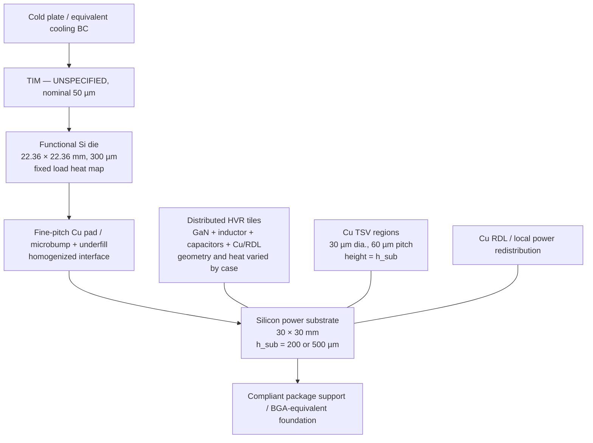
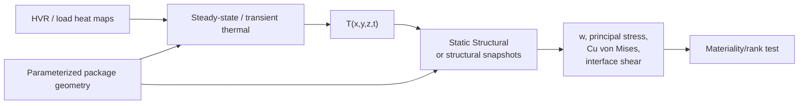
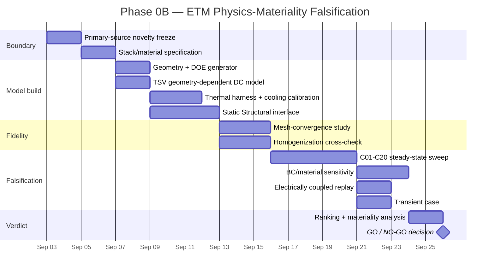
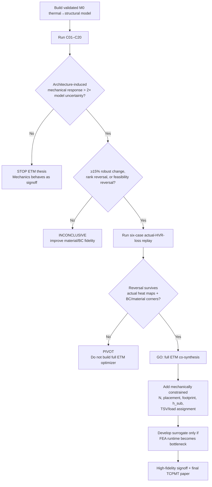

# NOVELTY_BOUNDARY_ETM_PHASE0B.md

## Executive assessment

### Decision

**Recommendation: proceed with Phase 0B, but do not yet build the full ETM optimizer.**

The literature audit supports a **conditional-go** thesis. The electrical and electrothermal portions of distributed vertical power-delivery synthesis are already substantially occupied by prior work from the same research lineage. ISCAS 2024 explicitly claims a methodology for determining the **optimal number and placement of distributed VRs**. ECTC 2024 advances this to model-guided PCB-to-POL DVPD design with an optimal number of compact distributed regulators and reports 85.6% efficiency for a 1-kW/500-mm² system. The June-2026 comprehensive DVPD framework then goes much further: it jointly determines VR count, sizing, placement, vertical stacking, switching frequency, component sizing, floorplanning, and vertical-interconnect allocation, and explicitly couples the optimized geometry and component heat maps to a converged thermal-fluidic loop. citeturn11search0turn11search1turn12view0turn13view5

Therefore, none of the following is independently sufficient as the headline contribution:

> optimal number of distributed VRs  
> optimal VR placement  
> vertical stacking  
> converter/package co-optimization  
> thermal-aware DVPD  
> transient-aware DVPD  
> online VR reconfiguration.

Your own existing HVR work already supplies generalized converter-level loss optimization, topology/component/frequency selection, current-density and footprint constraints, and packaging-aware 2-D versus vertically stacked design exploration. fileciteturn0file3 fileciteturn0file4 Your existing TSV work already provides scalable wideband RLCG/S-parameter and electrothermal models, anisotropic thermal homogenization, temperature feedback, surrogate acceleration, and HFSS/Mechanical signoff. fileciteturn0file2 Your transient package work further demonstrates that steady-state or one-way thermal analysis can miss important operating states and has already established a fast transient electrothermal solver validated against Icepak. fileciteturn0file1

The remaining opportunity is narrower:

> **Does explicit package mechanics alter the architecture that a state-of-the-art electrical/electrothermal DVPD synthesis framework would otherwise select?**

That question is not equivalent to “does temperature create stress?” Nor is it equivalent to “can ANSYS calculate warpage?”

The June-2026 DVPD paper actually creates an unusually strong opening for this question. It qualitatively argues that distributed VRs reduce stiffness gradients, CTE mismatch, stress concentration, and global warpage relative to a monolithic converter, and suggests that symmetric distributed placement can cause localized deformations to partially offset one another. Yet its optimization does not solve structural mechanics or use computed warpage/stress as architectural constraints. citeturn12view0

At the same time, **thermomechanical-aware placement itself is not new**. STAMP-2.5D already couples FEA temperature/stress to automated 2.5-D chiplet floorplanning and reports an approximately 11% stress reduction versus temperature-oriented optimization. ATMPlace jointly optimizes wirelength, peak temperature, and operational warpage and reports 5–27% warpage reductions. citeturn10academia47turn10academia46

The defensible gap is consequently the intersection:

\[
\boxed{
\text{converter synthesis}
+
\text{DVPD topology}
+
\text{vertical PDN}
+
\text{electrothermal fields}
+
\text{thermomechanical feasibility}
}
\]

where converter count, dimensions, power dissipation, placement, and interconnect structure are **outputs of the power-delivery synthesis**, rather than fixed chiplets supplied as inputs to a thermomechanical placer.

### What Phase 0B must answer

Before developing surrogates, mixed-integer optimization, keep-out generation, machine learning, runtime control, or full-wave signoff, run a deliberately small falsification experiment answering:

\[
\boxed{
\text{Does changing DVPD architecture produce a mechanically meaningful change?}
}
\]

More specifically:

\[
\mathcal X_{ET}
\longrightarrow
\{T(\mathbf r),w(\mathbf r),\sigma(\mathbf r)\}
\]

must demonstrate that the resulting mechanical response changes either:

1. the ranking of plausible electrical/electrothermal architectures;
2. the feasible set of architectures;
3. or at least one physically meaningful DVPD decision variable.

A strong result is a **design reversal**:

\[
x_A \prec_{ET} x_B
\qquad\text{but}\qquad
x_B \prec_{ETM} x_A .
\]

An equally acceptable result is a feasible-set reversal:

\[
x^*_{ET}\notin\mathcal X_{M},
\]

while another design \(x'\), with only a modest electrical penalty, satisfies the mechanical conditions:

\[
P_E(x') \le 1.05P_E(x^*_{ET}),
\qquad
x'\in\mathcal X_M.
\]

The 5% electrical-penalty criterion above is proposed as an **experiment-level engineering discriminator**, not a universal physical limit.

### Strongest potential paper claim if Phase 0B succeeds

The safest prospective novelty statement is:

> **A mechanically constrained electrothermal co-synthesis methodology for distributed vertical power delivery in which converter architecture, physical dimensions, power dissipation, vertical-interconnect geometry, and package structure are jointly coupled, so that package stress and warpage alter the feasible DVPD design space rather than being evaluated only after electrical optimization.**

A stronger claim becomes possible if Phase 0B demonstrates direct propagation such as

\[
\text{mechanics}
\rightarrow
\text{usable placement/footprint}
\rightarrow
\text{converter sizing}
\rightarrow
P_{\rm conv},
\]

but **the experiment must not require that specific mechanism to succeed**. The mechanical constraint may instead alter \(N_{\rm VR}\), spatial distribution, aspect ratio, substrate thickness, vertical layer assignment, TSV allocation, or load assignment.

### Why thickness is especially promising

Substrate/power-layer thickness is a particularly good Phase-0B variable because it spans all three domains. Electrically it changes vertical interconnect length and resistance; thermally it changes conduction resistance and spreading; mechanically it changes bending stiffness, neutral-axis location, CTE-driven curvature, and interconnect deformation. The June-2026 DVPD study uses 300-µm TSV heights in its representative power-layer stack, while independent 3-D package experiments/FEA have demonstrated significant thermomechanical dependence on silicon thickness and reported an interposer-thickness region around 100–200 µm minimizing interchip-joint stress in their particular test vehicle. citeturn13view2turn10search1

Thus the proposed \(h_{\rm sub}=200\) and \(500\,\mu\text{m}\) points are useful **bracketing cases**, but 500 µm should not be described as literature-optimal. It is deliberately an upper sensitivity point.

### Scope freeze for Phase 0B

The experiment should include:

\[
E \rightarrow T \rightarrow M
\]

with geometry-dependent power sources and realistic CTE/stiffness differences.

It should **not** yet include MAB control, lifetime/fatigue prediction, broadband 100-GHz S-parameters inside every FEA iteration, ML surrogates, full MINLP synthesis, or a claim of manufacturing qualification. Your prior work already establishes that the broadband TSV models and transient electrothermal machinery exist; Phase 0B only needs the minimum physics necessary to determine whether mechanics is scientifically consequential. fileciteturn0file1 fileciteturn0file2

### Source-access note

The current research environment exposes your prior attached papers and `NOVELTY_BOUNDARY_ETM.md`, but it does **not** expose a directly readable local copy of `deep-research-report_HVR.md` or the full ISCAS'24 and ECTC'24 PDFs under `/mnt/data`. Claude's preceding audit likewise recorded that those two full PDFs were unavailable to it. fileciteturn0file0

For this report, I therefore used the **full primary June-2026 manuscript** and the publisher/author-hosted bibliographic records and abstracts for ISCAS'24 and ECTC'24. Their headline overlap is unambiguous from those primary metadata pages, but a final manuscript-level novelty audit should still compare the local full PDFs sentence-by-sentence before submission. citeturn11search0turn11search1

## Prior-art boundary and formulation audit

### What the 2024 papers already occupy

ISCAS 2024 states that it considers distributed VPD, investigates architecture-specific VR design, and proposes a methodology to determine the **optimal number and placement of VRs** for a given power-delivery architecture. Its motivating regime is greater than 1 kW and greater than 2 A/mm². citeturn11search0

ECTC 2024 considers distributed vertical delivery using an “optimal number” of compact on/in-interposer regulators and analytical PCB-to-POL loss models. Its representative system delivers 1 kW to a 500-mm² functional die and reaches 85.6% system-wide efficiency. citeturn11search1

Those papers therefore preclude:

> “The first framework to optimize the number and placement of distributed VRs.”

They also make a paper based merely on adding your newer HVR loss model to a placement engine incremental unless a new physical feedback loop changes the architecture.

### June-2026 DVPD formulation and assumptions

The following audit extracts the primary June-2026 formulation in approximately manuscript order. “Overlap” identifies where the proposed ETM work must avoid re-claiming existing contributions.

| Primary-source statement / assumption | June-2026 formulation | Consequence for the new work |
|---|---|---|
| System boundary | End-to-end power delivery is evaluated from platform input to delivered POL load, including front-end conversion, embedded VR conversion, platform PDN and package PDN. citeturn12view0turn13view1 | New efficiency results must use the same boundary or state explicitly why they differ. |
| Architecture | DVPD uses many laterally distributed VRs whose active/passive components are vertically integrated under the functional load. citeturn12view0 | **OVERLAP:** distributed/vertical architecture is established. |
| Mechanical motivation | A monolithic embedded converter is claimed to cause stiffness gradients, CTE mismatch, warpage/delamination/shear; distribution is claimed to reduce peak stress concentration and global stiff regions. citeturn12view0 | **OPEN LOOP:** these claims are qualitative rather than optimized structural constraints. This is the main Phase-0B target. |
| Distribution variable | For \(M\) VRs, nominal per-VR current scales approximately as \(I_o/M\). citeturn12view0 | **OVERLAP:** VR count cannot be new by itself. |
| Scope of optimization | Framework determines degree of distribution, component sizing, placement and vertical stacking. citeturn12view0 | **OVERLAP:** all four already exist. |
| Integrated design | VR count, sizing, placement, stacking and interconnect allocation are jointly optimized under packaging constraints. citeturn12view0 | New work needs a new constraint/feedback, not another optimizer around the same variables. |
| Thermal coupling | Component-level loss maps and optimized geometry are passed into a thermal-fluidic solver that iteratively updates temperature-dependent losses and cooling until convergence. citeturn12view0turn13view5 | **OVERLAP:** “thermal-aware DVPD” is occupied. |
| Objective | Total power loss is minimized subject to footprint/power-density/ripple constraints. citeturn12view0 | Natural baseline objective for Phase 0B. |
| Frequency | Minimum feasible \(f_{\rm sw}\) follows the inductor voltage, permissible ripple, phase current and inductance: \(f_{\rm sw}^{\min}\propto\Delta V_L/(\gamma I_\phi L_\phi)\). citeturn12view0 | **OVERLAP:** frequency is already design-dependent. |
| Inductors | Unit inductors are paralleled according to \(N_L=\lceil I_\phi/I_{L0}\rceil\), giving \(L_\phi=L_0/N_L\). citeturn12view0 | Mechanical work can later alter available footprint/layer allocation, but modular sizing itself is not new. |
| Switch sizing | Optimum switch width scales as \(w_{\rm FET}^{opt}\propto (I_{ds}/V_{ds})/\sqrt{f_{\rm sw}}\). citeturn12view0turn13view0 | Existing analytical optimum becomes a useful downstream quantity if mechanics limits usable geometry. |
| Distribution scaling | With \(I_{ds}\propto1/M\), optimal switch width scales approximately as \(1/M\); total switch loss is approximately invariant in the idealized scaling argument. citeturn13view0 | New mechanics can break this similarity assumption. |
| Floorplanning | Components are arranged in an \(m\times n\) array under a fixed layer-area budget. citeturn13view0 | **OVERLAP:** regular array floorplanning exists. |
| Area constraint | \(w_{LS}^{max}=A_{\rm budget}/[M\max(l_{\rm ind},l_{LS})]\). citeturn13view0 | Potential, but not mandatory, route for mechanical feasibility to propagate into converter loss. |
| Area-induced electrical penalty | If \(w_{LS}^{opt}>w_{LS}^{max}\), the switch is shrunk and conduction loss rises. citeturn13view0 | Strong future co-synthesis mechanism if a **physically derived** mechanical exclusion changes usable area. |
| Intra-VR routing | Routing length shrinks with local VR dimensions; idealized routing loss scales approximately as \(1/M^2\). citeturn13view1 | Existing routing model is not mechanically constrained. |
| Similar-cell assumption | Distributed cells are assumed locally similar as \(M\) changes. citeturn13view1 | Mechanical asymmetry can invalidate this assumption. |
| Equal-current assumption | Each VR is designed for approximately \(1/M\) of maximum current in the routing-scaling derivation. citeturn13view1 | New framework may later make load assignment a decision variable. |
| **Critical explicit assumption** | Intra-VR routing is assumed not to be constrained by local blockages, keep-outs or package design rules. citeturn13view1 | **EXACT NOVELTY SEAM:** physically derived stress/warpage exclusion regions can break an assumption explicitly stated by the baseline. |
| Vertical interconnects | Number of BGAs/TSVs/pads is set by connection current and per-via current capability; allocated via current is assumed uniform. citeturn13view1 | Mechanical constraints on via density/location are absent. |
| Representative TSV | Cu TSVs: 30-µm diameter, 300-µm height and 60-µm pitch; RDL/chiplet pads use much finer geometry. citeturn13view2 | Strong baseline geometry for Phase 0B; 200/500 µm thickness sweep brackets the 300-µm nominal. |
| Case-study load | Main design-space study is 1 kW at 1 V over a 500-mm² load system at 2 A/mm². citeturn13view2 | Use for final paper; Phase 0B may use a smaller 240-A slice for fast falsification. |
| Preferred count | The DSCH example obtains \(M=70\) by numerically minimizing system loss; it is explicitly design-specific rather than universal. citeturn13view3 | Again, “optimal count” is established. |
| Placement geometry | Balanced VR cells with aspect ratio near one are preferred to reduce elongated routing. citeturn13view4 | Aspect ratio is already electrically motivated; Phase 0B asks whether mechanics changes the preferred ratio. |
| POL representation | Functional load is partitioned into 100 POL regions. citeturn13view4 | Spatially resolved load models already exist. |
| Assignment behavior | Current is described as being primarily supplied by nearby VRs; central VRs consequently carry more and corner POLs have fewer parallel paths. citeturn13view4 | A future free \(a_{ij}\) assignment variable remains potentially novel, but it is not needed for Phase 0B. |
| Thermal result | 70-VR direct 48→1 V case is 185 W loss isothermally; without thermal management the junction exceeds 110°C and loss rises to 225 W. citeturn13view5 | Demonstrates that electrothermal feedback is already quantitatively important. |
| Cooled result | Microchannel cooling limits \(T_{\max}\) to about 84°C and converges to 210 W system loss / 82.6% end-to-end efficiency. citeturn13view5 | ET baseline should reproduce or remain compatible with this behavior before ETM claims. |

### Contradictions and important qualifications

The principal contradiction is not between the sources but between a **possible new-paper claim** and the literature.

The statement

> “Mechanically aware physical synthesis is unexplored”

would be too broad because STAMP-2.5D and ATMPlace already optimize thermomechanical package placement. citeturn10academia47turn10academia46

The more defensible statement is:

> **Thermomechanical constraints have not yet been closed around the synthesized DVPD converter architecture so that VR count/geometry/dissipation/interconnect structure themselves can change in response to mechanical feasibility.**

Another crucial qualification concerns temperature gradients. Your transient electrothermal work correctly treats a gradient limit as an explicit modeling assumption for screening, rather than claiming that a temperature gradient itself is a structural-stress computation. fileciteturn0file1 For this project,

\[
\nabla T \ne \sigma .
\]

Actual structural output should be obtained from

\[
\epsilon_{\rm th}
=
\boldsymbol{\alpha}\Delta T,
\]

together with the elastic/thermoelastic constitutive law and mechanical boundary/interface conditions. ANSYS itself notes that thermal stresses arise when thermal expansion is impeded by supports or bonded materials with differing CTEs/temperatures and requires CTE plus a temperature field for structural thermal-stress solutions. citeturn7search1

### The novelty test Phase 0B must enforce

A post-processing sequence,

\[
x^*_{ET}
\rightarrow
\text{ANSYS}
\rightarrow
\text{stress plot},
\]

is **not sufficient**.

The experiment needs evidence that

\[
g_M(x)
\]

is architecture-dependent enough that later co-synthesis is justified:

\[
x^*_{ET}
\ne
x^*_{ETM}
\]

or that the feasible region changes materially:

\[
\mathcal X_{ETM}
\subsetneq
\mathcal X_{ET}.
\]

That is the sole question Phase 0B needs to settle.

## Phase-zero-B package test vehicle

### Recommended test vehicle

For Phase 0B, I recommend **not** beginning with the full three-power-layer June-2026 geometry. It creates too many simultaneous uncertainties—embedded component manufacturing, multiple substrates, cooling channels, inter-layer bonding, TSV density and component materials—before the basic thesis is known to be true.

Instead, use a mechanically faithful reduced-order test vehicle representing one DVPD power substrate beneath a functional die:



The 22.36-mm square load die is exactly 500 mm², matching the June-2026 reference footprint. The global power substrate is slightly larger so edge effects and mechanical support can be resolved. The June baseline's Cu TSV geometry of 30-µm diameter, 60-µm pitch and 300-µm nominal height supplies the reference interconnect geometry; Phase 0B changes height to 200 and 500 µm to deliberately test the thickness coupling. citeturn13view2

The final journal can restore the full vertically stacked three-layer architecture after a GO decision.

### Electrical and thermal parity

Use a **240-W Phase-0B electrical load**, at:

\[
V_{\rm POL}=1\text{ V},
\qquad
I_{\rm total}=240\text{ A}.
\]

This is deliberately smaller than the final 1-kW benchmark. It makes \(N_{\rm VR}=2\)–8 physically manageable for the falsification experiment while retaining high-current power-delivery behavior. The final paper, if Phase 0B succeeds, must repeat key results at the 1-kW/500-mm² scale used by the June-2026 framework. citeturn13view2

This choice is also compatible with your existing converter work. Your 2026 48→1-V DPMIH example reports approximately 14 W conversion loss at 80 A and roughly 85% efficiency. fileciteturn0file6

For the **controlled mechanical DOE**, fix total HVR heat at the provisional value

\[
P_{\rm HVR,ref}=42~{\rm W},
\]

which is approximately the loss obtained by scaling that 80-A reference to three equal 80-A units. This value is deliberately held constant across the main geometry experiments so that an \(N_{\rm VR}\) effect is not trivially caused by changing total heat.

Mark this in the configuration file as:

> **UNSPECIFIED / PROVISIONAL — replace with the HVR compiler output before publication.**

Then run a smaller electrically coupled subset in which each architecture uses

\[
P_{\rm HVR}(N,\text{geometry},T)
\]

from your actual generalized HVR loss model.

That separates two questions:

\[
\text{geometry-only mechanical sensitivity}
\]

from

\[
\text{real electrothermal-mechanical sensitivity}.
\]

### Proposed global geometry

| Feature | Phase-0B value | Status / rationale |
|---|---:|---|
| Functional die | \(22.36\times22.36\) mm² | 500-mm² reference footprint used by June DVPD study. citeturn13view2 |
| Si die thickness | 300 µm | **UNSPECIFIED default.** Sensitivity 200–500 µm only if necessary. |
| Power substrate | \(30\times30\) mm² silicon | Recommended reduced-order test vehicle. |
| \(h_{\rm sub}\) | 200 and 500 µm | Required Phase-0B sweep; nominal June TSV height is 300 µm. citeturn13view2 |
| TSV diameter | 30 µm | June baseline. citeturn13view2 |
| TSV pitch | 60 µm | June baseline. citeturn13view2 |
| TSV liner | 1 µm SiO₂ | **UNSPECIFIED default**; replace with process value. |
| Upper fine-pitch interface | 20-µm pitch, ~10-µm vertical scale | Consistent with June chiplet-pad interface. citeturn13view2 |
| RDL Cu thickness | 5 µm | **UNSPECIFIED default.** Sweep only in local submodel. |
| TIM | 50 µm | **UNSPECIFIED default.** |
| Cooling | top equivalent cold-plate Robin BC | Calibrate rather than invent \(h\). |
| Ambient/coolant | 25°C | Phase-0B reference. |
| Stress-free temperature | 25°C for operational-only study | Then add assembly-history sensitivity; not a manufacturing signoff assumption. |
| Functional-die heat | 240 W fixed in all controlled cases | Maintains load parity. |
| HVR heat | 42 W nominal total | **PROVISIONAL**; geometry DOE only. |
| HVR heat sensitivity | 31.5 / 42 / 52.5 W | 0.75× / 1× / 1.25× uncertainty sweep. |

### Material card

Phase 0B should use temperature-dependent thermal conductivity where readily available but begin structural screening with linear thermoelasticity.

| Region | \(E\) | \(\nu\) | CTE | Thermal \(k\) | Phase-0B treatment |
|---|---:|---:|---:|---:|---|
| Single-crystal Si | Prefer cubic \(C_{11}=166\), \(C_{12}=64\), \(C_{44}=79.6\) GPa | anisotropic | \(2.6\) ppm/K | ~130–150 W/mK at 300 K | **Preferred:** anisotropic elasticity; isotropic \(E=130\) GPa, \(\nu=0.28\) only as check. Silicon elastic constants and 300-K CTE are supported by semiconductor-property references. citeturn9search8turn14search0 |
| Cu TSV/RDL | 110 GPa nominal | 0.34 | 16.66 ppm/K | ~400 W/mK at room T | Use temperature-dependent plasticity only after linear screen. NIST provides temperature-property references for OFHC copper and gives room-temperature CTE/conductivity benchmarks. citeturn9search2turn9search6 |
| SiO₂ liner | 71.7 GPa | 0.17 | 0.57 ppm/K | 1.38 W/mK | Fused-silica proxy; process oxide should replace for signoff. citeturn15search0turn15search2 |
| Underfill | 8 GPa nominal | 0.32 | 30 ppm/K nominal | 0.7 W/mK | **UNSPECIFIED and high-risk.** Use actual vendor \(E(T),\alpha(T),T_g\) before publication; sweep \(E\) ±30% and CTE ±30% now. |
| Effective VR tile | 120 GPa nominal | 0.28 | 6 ppm/K | 60 W/mK | **UNSPECIFIED surrogate material.** Derive from actual GaN/passive/carrier volume fractions; sensitivity \(E=80\)–160 GPa, CTE 4–10 ppm/K. |
| TIM | 0.05–0.5 GPa | ~0.45 | **UNSPECIFIED** | from actual TIM | Thermally important; mechanically model as compliant layer rather than rigid bond. |
| BGA/support foundation | effective springs | — | — | — | Do not initially resolve thousands of balls globally. Validate one explicit local model if Phase 0B passes. |

The biggest material uncertainty is **not silicon or copper; it is the effective HVR tile, underfill/adhesive and package support**. The IEEE TCPMT review of 2.5-D packaging emphasizes that warpage and interconnect reliability depend materially on both geometry and material selection. citeturn10search0

Consequently, any design reversal that disappears under a modest underfill or support-property perturbation should be classified **INCONCLUSIVE**, not GO.

### HVR tile representation

Do not model the HVR tile initially as a single arbitrary solid without checking it.

Use two fidelity levels:

\[
\text{M0: homogenized tile}
\]

for all DOE cases, and

\[
\text{M1: explicit component tile}
\]

for two representative configurations.

M0 preserves:

- tile footprint \(A_x\times A_y\);
- tile total thickness;
- total heat;
- heat centroid;
- effective in-plane and vertical conductivity;
- effective stiffness;
- effective CTE.

M1 explicitly separates at least:

- GaN switch region;
- inductor region;
- capacitor region;
- Cu/RDL;
- carrier/encapsulant.

This mirrors the successful multi-fidelity philosophy already used in your TSV work, where analytical/homogenized models are validated against full geometry and high-fidelity Ansys models rather than using full FEM for every design. fileciteturn0file2

### Cooling boundary calibration

Do **not** choose a heat-transfer coefficient because it “looks reasonable.”

Define:

\[
-k\nabla T\cdot\mathbf n
=
h_{\rm top}(T-T_{\rm coolant}),
\]

with \(T_{\rm coolant}=25^\circ\text{C}\).

Determine \(h_{\rm top}\) in a one-dimensional calibration step so a reference geometry produces a realistic package temperature, then freeze \(h_{\rm top}\) for the entire DOE. ANSYS supports convection boundary conditions and transfer of thermal solutions into structural analyses. citeturn7search14turn7search10

If the existing Icepak/DVPD thermal geometry can reproduce approximately the June baseline's 84°C cooled result, that calibration is preferable to an assumed coefficient. citeturn13view5

## Physics-materiality FEA matrix

### Placement definitions

Use a common coordinate system with the die center at \((0,0)\).

The precise coordinates should be generated automatically so that the outer edge of every HVR tile remains inside the legal placement region.

The placement classes are:

```text
Central / compact                 Distributed                 Edge-biased
+--------------------+            +--------------------+       +--------------------+
|                    |            |  V             V   |       | V                V |
|       V   V        |            |                    |       |                    |
|       V   V        |            |        DIE         |       |        DIE         |
|                    |            |                    |       |                    |
|                    |            |  V             V   |       | V                V |
+--------------------+            +--------------------+       +--------------------+

Asymmetric
+--------------------+
| V   V              |
| V                  |
|        DIE         |
| V                  |
| V   V              |
+--------------------+
```

The asymmetric patterns are essential. A completely symmetric benchmark could artificially favor both electrical and mechanical heuristics and hide the coupling.

### Normalized footprint rule

For the controlled count sweep, keep total HVR footprint constant:

\[
A_{\rm VR,total}=96~{\rm mm^2}
\]

and therefore

\[
A_{\rm tile}
=
\frac{96}{N_{\rm VR}}\ {\rm mm^2}.
\]

Square-tile dimensions become approximately:

| \(N_{\rm VR}\) | area per tile | square side |
|---:|---:|---:|
| 2 | 48 mm² | 6.93 mm |
| 4 | 24 mm² | 4.90 mm |
| 6 | 16 mm² | 4.00 mm |
| 8 | 12 mm² | 3.46 mm |

This prevents the first test from conflating “more VRs” with “more total embedded stiff material.”

For aspect-ratio tests, maintain constant area and use:

\[
AR=\frac{A_x}{A_y}=2
\]

so, for a 24-mm² tile,

\[
A_x=6.93~{\rm mm},
\qquad
A_y=3.46~{\rm mm}.
\]

### Controlled DOE

All cases below use:

\[
P_{\rm die}=240\text{ W},\quad
V_{\rm POL}=1\text{ V},\quad
I_{\rm total}=240\text{ A},
\]

unless explicitly stated otherwise.

For nominal cases,

\[
P_{\rm HVR,total}=42\text{ W},
\qquad
P_{\rm VR}=\frac{42}{N_{\rm VR}}.
\]

| Case | \(N_{\rm VR}\) | placement | tile geometry | \(h_{\rm sub}\) | total HVR heat | heat / VR | electrical parity | Mechanical question |
|---|---:|---|---|---:|---:|---:|---|---|
| C01 | 2 | compact central pair | 6.93×6.93 mm | 200 µm | 42 W | 21 W | same 240-W load | Does a small number of large stiff/thermal islands create global curvature? |
| C02 | 2 | opposing edge pair | 6.93×6.93 | 200 | 42 | 21 | same | Does moving identical material outward increase/decrease warpage and edge/interface stress? |
| C03 | 2 | compact central | 6.93×6.93 | 500 | 42 | 21 | same | Count held fixed; isolates substrate-thickness sensitivity. |
| C04 | 4 | compact 2×2 central | 4.90×4.90 | 200 | 42 | 10.5 | same | Electrical-style compact placement versus stress localization. |
| C05 | 4 | distributed 2×2 | 4.90×4.90 | 200 | 42 | 10.5 | same | Canonical distributed architecture. |
| C06 | 4 | edge/corner biased | 4.90×4.90 | 200 | 42 | 10.5 | same | Tests package-edge curvature and interface stress. |
| C07 | 4 | asymmetric-left | 4.90×4.90 | 200 | 42 | 10.5 | same | Deliberately breaks symmetry; likely high-discrimination case. |
| C08 | 4 | distributed 2×2 | 4.90×4.90 | 500 | 42 | 10.5 | same | Direct \(h_{\rm sub}\) counterpart to C05. |
| C09 | 4 | distributed | 6.93×3.46, AR=2 | 200 | 42 | 10.5 | same | Does aspect ratio matter mechanically even at fixed area/heat? |
| C10 | 4 | distributed, rotated 90° | 3.46×6.93 | 200 | 42 | 10.5 | same | Detect anisotropy caused by support/RDL/Si orientation. |
| C11 | 4 | distributed | area = 18 mm²/VR | 200 | 42 | 10.5 | same | 25% lower total embedded footprint; stiffness/power-density sensitivity. |
| C12 | 4 | distributed | area = 30 mm²/VR | 200 | 42 | 10.5 | same | 25% larger footprint; direct comparison with C11. |
| C13 | 6 | distributed 3×2 | 4.00×4.00 | 200 | 42 | 7.0 | same | Tests finer distribution at constant total area. |
| C14 | 6 | perimeter/ring | 4.00×4.00 | 200 | 42 | 7.0 | same | Tests edge-weighted symmetry. |
| C15 | 6 | asymmetric | 4.00×4.00 | 200 | 42 | 7.0 | same | Tests sensitivity to heterogeneous load/placement. |
| C16 | 6 | distributed 3×2 | 4.00×4.00 | 500 | 42 | 7.0 | same | Thickness counterpart to C13. |
| C17 | 8 | uniformly distributed | 3.46×3.46 | 200 | 42 | 5.25 | same | Many small heat/stiffness islands. |
| C18 | 8 | perimeter-biased | 3.46×3.46 | 500 | 42 | 5.25 | same | Combines high distribution and thick substrate. |
| C19 | 4 | asymmetric C07 geometry | 4.90×4.90 | 200 | **31.5 W** | 7.875 | same load; low-loss corner | Separates geometry effect from HVR-loss uncertainty. |
| C20 | 4 | asymmetric C07 geometry | 4.90×4.90 | 200 | **52.5 W** | 13.125 | same load; high-loss corner | Tests whether materiality depends on converter heat. |

Twenty cases are enough to span the requested dimensions while remaining small enough for high-fidelity verification.

### Why this matrix is more informative than “top ten ET designs”

Selecting only the top ten electrical solutions would risk sampling nearly identical layouts. If all have similar geometry, mechanics might appear irrelevant simply because the experiment never perturbed the variables that drive bending and CTE mismatch.

The matrix deliberately varies:

\[
N_{\rm VR},
\quad
(x,y),
\quad
AR,
\quad
A_{\rm tile},
\quad
h_{\rm sub},
\quad
q_{\rm VR}.
\]

This tests the **Jacobian of mechanical response** with respect to the eventual synthesis variables:

\[
\frac{\partial(w,\sigma,\tau)}
{\partial(N,x,y,AR,A,h,q)}.
\]

Only after demonstrating non-negligible sensitivity should those variables be placed in the optimization loop.

### Electrically coupled replay subset

After C01–C20 are solved under controlled total heat, select six cases:

\[
\{C01,C05,C07,C13,C17,\text{best mechanical case}\}
\]

and replace 42 W with the actual HVR loss-model output:

\[
P_{\rm HVR}
=
P_{\rm cond}
+
P_{\rm sw}
+
P_{\rm passive}
+
P_{\rm local\,routing}.
\]

Your generalized HVR framework is already sufficiently accurate for architecture-level DSE: the newer model-driven implementation reports approximately 95.27% loss-prediction accuracy against Cadence and explicitly optimizes devices, passives, frequency and package constraints. fileciteturn0file3

This six-case replay is the first genuine

\[
E\rightarrow T\rightarrow M
\]

experiment.

### Transient case

Use C07 or whichever steady-state case generates the strongest combination of thermal asymmetry and mechanical sensitivity.

Precondition at:

\[
P_{\rm die}=60~{\rm W}
\]

and

\[
P_{\rm HVR}=10.5~{\rm W}
\]

for a 25%-load operating point.

At \(t=0\), step to:

\[
P_{\rm die}=240~{\rm W},
\qquad
P_{\rm HVR}=42~{\rm W}.
\]

Solve transient thermal fields at logarithmically distributed output times:

\[
1~\mu{\rm s},
10~\mu{\rm s},
100~\mu{\rm s},
1~{\rm ms},
10~{\rm ms},
100~{\rm ms},
1~{\rm s},
\]

extending until either steady state or less than 1% temperature change over the final decade.

Import selected temperature snapshots into quasi-static structural solves and evaluate:

\[
w_{\max}(t),
\quad
\sigma_{\rm Si}(t),
\quad
\sigma_{\rm Cu}(t),
\quad
\tau_{\rm int}(t).
\]

The existing fast transient electrothermal solver is especially useful here. It solves the anisotropic transient heat equation, reuses a factorized conduction operator, and has been validated against Icepak across multiple regimes to within 2.4°C per die while being roughly two orders of magnitude faster in the reported study. fileciteturn0file1

The transient Phase-0B question is simply:

> **Does the mechanically worst time coincide with thermal steady state?**

If yes, the eventual architecture optimizer can remain predominantly steady-state mechanical. If not, transient mechanical feasibility becomes potentially publication-relevant.

## Simulation protocol and fidelity controls

### Global analysis chain

Use one-way sequential coupling initially:

\[
P(\mathbf r)
\rightarrow
T(\mathbf r)
\rightarrow
\epsilon_{\rm th}(\mathbf r)
\rightarrow
\sigma(\mathbf r),w(\mathbf r).
\]

This is standard and directly supported by ANSYS workflows: a steady-state thermal solution can transfer temperature fields into Static Structural, and Icepak or Mechanical thermal results can be mapped into a structural model for stress and displacement calculations. citeturn7search7turn7search10



### Thermal model

Solve:

\[
\rho c_p\frac{\partial T}{\partial t}
=
\nabla\cdot(\mathbf K\nabla T)+Q.
\]

For steady-state:

\[
\nabla\cdot(\mathbf K\nabla T)+Q=0.
\]

Your existing package transient framework already uses anisotropic equivalent conductivity for dense TSV regions and harmonic-mean interface conductance, and validates both the homogenization and resulting package temperatures against explicit Icepak structures. fileciteturn0file1

Therefore the recommended global representation is:

- homogenized TSV regions for the 20-case DOE;
- explicit TSVs only in local submodels;
- component-resolved HVR heat map where practical;
- otherwise a tile heat map preserving source centroid and total heat.

### Structural model

For isotropic materials:

\[
\boldsymbol{\epsilon}
=
\boldsymbol{\epsilon}_{e}
+
\boldsymbol{\epsilon}_{th},
\]

\[
\boldsymbol{\epsilon}_{th}
=
\alpha(T-T_{\rm ref})\mathbf I.
\]

For crystalline silicon, use its cubic elastic tensor rather than blindly treating it as an isotropic ductile metal. Silicon's room-temperature elastic constants differ substantially by crystallographic direction. citeturn9search8

Use the following failure metrics:

**Silicon / brittle semiconductor**

\[
\sigma_{1,\max}
\]

maximum principal tensile stress, plus warpage. Do not use von Mises as the sole silicon reliability indicator.

**Copper TSV/RDL**

\[
\sigma_{\rm vm,Cu}
\]

and, when nonlinear material data become available,

\[
\epsilon^{p}_{eq}.
\]

**Bond/interface**

\[
\tau_{\rm int}
=
\sqrt{\tau_{xz}^2+\tau_{yz}^2},
\]

and peel:

\[
\sigma_{zz}.
\]

**Warpage**

Report peak-to-valley displacement:

\[
w_{\rm p-v}
=
\max(z_{\rm def})-\min(z_{\rm def})
\]

separately for the functional die and overall package.

### Structural boundary conditions

Do not use one fully fixed package underside as the only model. ANSYS explicitly warns that supports should prevent rigid-body motion without significantly impeding expected thermal deformation, because over-constrained supports exaggerate stress. citeturn7search1

Use three variants on the discriminating subset.

**BC-A — minimally constrained free warpage**

Use a 3-2-1 rigid-body suppression scheme: one reference point removes three translations; a second removes two remaining rotations; a third removes the final rotation. The package is otherwise free to expand.

This should be the **primary global-warpage model**.

**BC-B — compliant board/BGA support**

Replace the lower BGA region by distributed normal/in-plane foundation stiffness:

\[
k_x,\;k_y,\;k_z.
\]

Calibrate these from either an explicit BGA unit-cell model or package/board data.

**BC-C — assembly-mounted envelope**

Use a mechanically more restrictive support representing an attached board/cold-plate configuration.

A claimed design reversal should ideally survive at least BC-A and BC-B.

### Reference temperature and assembly stress

The main Phase-0B run should compute **operational incremental stress** with:

\[
T_{\rm ref}=25^\circ\text{C}.
\]

That intentionally isolates the question “does the operating power architecture produce different mechanical response?”

However, this is not the eventual total package stress:

\[
\sigma_{\rm total}
=
\sigma_{\rm assembly}
+
\Delta\sigma_{\rm operation}.
\]

The IEEE thermomechanical packaging literature treats warpage and interconnect reliability as strongly dependent on package construction, materials and assembly conditions. citeturn10search0

Therefore, on the six discriminating cases add an **assembly-history sensitivity** using the actual stress-free/cure/attach temperature when available.

Until process data are known:

> **OPEN DECISION — \(T_{\rm cure/attach}\).**

Do not invent a universal cure temperature in the journal.

### Mesh requirements

The global mesh should be fine enough to converge **ranking-level quantities**, not merely solver residuals.

Recommended first-pass rules:

- at least 4–6 elements through the silicon substrate thickness;
- 3–4 through the die thickness;
- local refinement around VR edges and transitions;
- conformal refinement around local explicit TSV/RDL interfaces;
- element aspect ratio kept reasonable in stress-critical regions;
- quadratic structural elements if available;
- do not read a sharp-corner stress singularity as a reliability limit.

Run at least three meshes:

\[
M_1,\quad M_2,\quad M_3.
\]

Require approximately:

\[
\frac{|w_{M_3}-w_{M_2}|}{w_{M_3}}<5\%
\]

for global warpage and:

\[
\frac{|\bar{\sigma}_{M_3}-\bar{\sigma}_{M_2}|}
{\bar{\sigma}_{M_3}}<10\%
\]

for a **regularized local stress metric**.

These are **validation targets**, not physical reliability thresholds.

For local stress, use one of:

- average over a fixed physical volume;
- 95th/99th percentile over a defined critical region;
- stress a fixed distance from the material corner;
- path-integrated/interface-energy metric.

Never compare the single highest nodal stress from meshes of different density.

### Homogenization validation

Your TSV work already provides the appropriate methodology. Equivalent anisotropic thermal blocks were compared against explicitly resolved TSV geometry, and your existing codebase contains a homogenized-versus-explicit simulation pattern. fileciteturn0file2

For Phase 0B, perform two cross-checks:

\[
\text{H0: global homogenized TSV/HVR model}
\]

versus

\[
\text{H1: explicit local geometry}.
\]

Select:

- one central VR location;
- one edge/asymmetric VR location.

Compare:

\[
T_{\max},
\quad
w,
\quad
\sigma_{\rm local},
\quad
\tau_{\rm interface}.
\]

The homogenized model need not reproduce every singular local peak. It must preserve the **architecture ranking and mechanically relevant field trends**.

### Existing code worth reusing

Claude's repository audit identifies two especially valuable assets:

`HVR_OPT/tessera-master_2/revision/coupled_electrothermal_hfss_mechanical.py`

and

`HVR_OPT/tessera-master_2/FEM/HFSS_RUN_SINGLE_LINE_THERMAL_MECH_REGION_v2.py`.

According to the attached audit, the former already provides a PyAEDT HFSS↔Mechanical/thermal harness, while the latter implements the useful explicit-versus-homogenized modeling pattern. Neither currently supplies the Static Structural warpage/stress stage required for this paper. fileciteturn0file0

The critical addition is therefore conceptually small:

```text
existing:
geometry → electrical loss → thermal Mechanical/Icepak → T

add:
T → Static Structural → w / stress / interface metrics
```

ANSYS Mechanical explicitly supports imported thermal conditions for structural analysis, and PyAEDT exposes Mechanical APIs for thermal conditions/maps. citeturn7search0turn7search17

### Minimal software stack

Preferred:

| Function | Primary tool | Why |
|---|---|---|
| Parameter generation | Python | reproducible case matrix |
| Converter heat maps | existing HVR analytical framework | already validated for fast DSE. fileciteturn0file3turn0file4 |
| Fast thermal pre-screen | existing FVM electrothermal code | already validated against Icepak. fileciteturn0file1 |
| Thermal reference | ANSYS Icepak or Mechanical Thermal | high-fidelity package reference |
| Structural | ANSYS Mechanical Static Structural | direct imported-temperature workflow. citeturn7search10turn7search1 |
| Automation | PyAEDT / PyMechanical | compatible with existing scripts |
| TSV signoff | existing HFSS/RLCG flow | only on selected designs. fileciteturn0file2 |

If ANSYS structural licensing is unavailable, **CalculiX** is a credible open-source fallback for static, heat-transfer and coupled/uncoupled temperature-displacement analyses; **Elmer FEM** is another open-source multiphysics solver supporting structural mechanics and heat transfer. citeturn8search3turn8search1

For a TCPMT paper, however, the strongest validation path is still:

\[
\text{fast analytical/reduced model}
\rightarrow
\text{ANSYS high-fidelity signoff}.
\]

### Validation checklist

Before interpreting any architecture result:

- [ ] Same geometry is used by thermal and structural models.
- [ ] Energy balance closes to within the predefined thermal tolerance.
- [ ] \(T_{\max}\) is mesh-converged.
- [ ] Die warpage is mesh-converged to the 5% target.
- [ ] Regularized critical stresses are converged to the 10% target.
- [ ] Support reactions sum correctly and no artificial rigid-body mode remains.
- [ ] BC-A versus BC-B does not reverse every conclusion.
- [ ] Homogenized and explicit local models agree on trend/ranking.
- [ ] Temperature mapping conserves spatial location and does not smooth away hotspots.
- [ ] Silicon principal stress, Cu von Mises stress and interface shear are extracted separately.
- [ ] Sharp-edge singularities are excluded from headline stress values.
- [ ] Material \(E\), CTE and thermal conductivity sources are archived in the experiment metadata.
- [ ] Underfill/VR effective-property sensitivity has been performed.
- [ ] The entire case can be regenerated from one YAML/JSON input.

## Decision rules and falsification logic

### Why there should not be one arbitrary “100 MPa” limit

There is no universal package stress threshold applicable across silicon, Cu TSVs, RDL, solder, underfill and interfaces. Likewise, allowable warpage depends on package size, bump geometry, board/assembly process and measurement condition. The IEEE TCPMT review explicitly treats thermomechanical reliability as a coupled materials/geometry/interconnect problem rather than a single universal limit. citeturn10search0

Therefore Phase 0B should use **two levels of decision criterion**:

1. threshold-free architecture sensitivity;
2. threshold-dependent feasibility using actual material/process allowables when available.

This prevents an arbitrary limit from manufacturing the desired conclusion.

### Mechanical materiality metric

For each metric \(m\in\{w,\sigma_{\rm Si},\sigma_{\rm Cu},\tau_{\rm int}\}\), define:

\[
S_m
=
\frac{m_{\max}-m_{\min}}
{m_{\rm median}}.
\]

Also determine numerical uncertainty \(u_m\) from mesh, homogenization and BC sensitivity.

Declare an architectural mechanical effect **resolved** only if:

\[
S_m > 2u_m.
\]

Then classify magnitude.

**Weak materiality**

\[
10\% \le S_m <15\%.
\]

**Moderate materiality**

\[
15\% \le S_m <25\%.
\]

**Strong materiality**

\[
S_m\ge25\%.
\]

The 10–15% boundary is not a reliability threshold. It is an experiment-level effect-size criterion informed by the scale at which recent thermomechanical placement works report useful architectural improvements: STAMP-2.5D reports about an 11% stress reduction, while ATMPlace reports 5–27% warpage improvement. citeturn10academia47turn10academia46

Thus a 1–3% mechanical difference that is comparable with FEA/model uncertainty is unlikely to support a compelling new co-synthesis paper.

### Ranking test

After the controlled DOE, assign each case:

\[
J_{ET}
\]

from electrical/thermal performance and calculate mechanical metrics separately.

Do **not** initially hide mechanics inside a weighted objective.

Compare rankings using Spearman rank correlation:

\[
\rho_s
=
\rho
(
{\rm rank}_{ET},
{\rm rank}_{ETM}
).
\]

Suggested interpretation:

| Result | Interpretation |
|---|---|
| \(\rho_s>0.95\) and no candidate changes feasibility | mechanics probably has little architectural value |
| \(0.90<\rho_s\le0.95\) | weak/inconclusive coupling |
| \(0.75<\rho_s\le0.90\) | meaningful ranking effect |
| \(\rho_s\le0.75\) | strong design-order reversal |

Again, these are **pre-registered experiment criteria**, not natural physical constants.

### Feasibility utilization

Once proper allowables are known, avoid comparing raw stresses from different materials.

Define:

\[
U_{\rm Si}
=
\frac{\sigma_{1,\rm Si}}
{\sigma_{\rm allow,Si}},
\]

\[
U_{\rm Cu}
=
\frac{\sigma_{\rm vm,Cu}}
{\sigma_{y,\rm Cu}(T)},
\]

\[
U_{\tau}
=
\frac{\tau_{\rm interface}}
{\tau_{\rm allow}},
\]

and a process-specific warpage utilization:

\[
U_w
=
\frac{w_{\rm p-v}}
{w_{\rm allow}}.
\]

Then:

\[
U_M
=
\max(U_{\rm Si},U_{\rm Cu},U_\tau,U_w).
\]

Mechanically feasible:

\[
U_M\le1.
\]

**OPEN DECISION:** \(w_{\rm allow}\), silicon strength, interface allowable and actual Cu yield model must be supplied from the selected process/material stack before the final paper.

For Phase 0B, sweep each unknown allowable by at least ±25% around its eventual nominal value and ask whether the architectural conclusion survives.

### Primary GO criteria

A **GO** to the full ETM co-synthesis paper requires at least one of G1/G2 plus G3.

**G1 — architecture reversal**

At least one discrete architecture decision changes:

\[
N_{\rm VR},
\quad
\text{placement class},
\quad
AR,
\quad
A_{\rm tile},
\quad
h_{\rm sub},
\]

when mechanics is included, while the selected alternative incurs no more than approximately 5% electrical/electrothermal objective degradation.

**G2 — feasible-set reversal**

An electrically/electrothermally attractive design becomes mechanically infeasible over a credible range of mechanical allowables and there exists a mechanically feasible alternative close to the ET optimum.

**G3 — robust physical signal**

At least one mechanically relevant metric changes by:

\[
\ge 15\%
\]

between architectural choices **and** by more than twice the combined numerical/model uncertainty.

### Strong-GO criterion

The most compelling result is:

\[
x^*_{ET}
\rightarrow
\text{mechanical failure}
\]

while

\[
x^*_{ETM}
\rightarrow
\text{pass}
\]

and

\[
\frac{J_E(x^*_{ETM})-J_E(x^*_{ET})}
{J_E(x^*_{ET})}
\le5\%.
\]

For example—not a predicted outcome:

```text
E optimum:
4 compact VRs
lowest loss
acceptable Tmax
high warpage/interface stress

ET optimum:
4 outward-shifted VRs
slightly better Tmax
still mechanically unacceptable

ETM optimum:
6 smaller distributed VRs
+2.3% electrical cost
mechanically acceptable
```

The important result is the **reversal**, not “six” specifically.

### Extra-strong co-synthesis criterion

If a mechanically derived exclusion region or usable-area constraint subsequently changes a converter dimension, the paper becomes considerably stronger.

The existing June formulation gives:

\[
w_{LS}^{\max}
=
\frac{A_{\rm budget}}
{M\max(l_{\rm ind},l_{LS})}
\]

and demonstrates that restricting \(w_{LS}\) below its electrical optimum raises conduction loss. citeturn13view0

A future physically valid chain could therefore be:

\[
g_M(x)\rightarrow A_{\rm usable}
\rightarrow w_{LS}^{\max}
\rightarrow w_{LS}
\rightarrow P_{\rm cond}.
\]

However, avoid the circular formulation:

\[
\text{VR creates stress}
\rightarrow
\text{VR creates its own keep-out}
\rightarrow
\text{VR disappears}.
\]

A keep-out must instead be derived from an incremental placement feasibility condition, neighboring structures, TSV/RDL stress interaction, or a local allowable-distance rule validated by FEA.

### Thickness-specific GO criterion

Substrate thickness should be considered a genuine three-way coupling variable if:

\[
h_{\rm sub}=200\rightarrow500~\mu{\rm m}
\]

produces a mechanically resolved response and also produces non-negligible electrical/thermal consequences.

The electrical model must ultimately replace hard-coded TSV resistance with:

\[
R_{\rm TSV}(T)
=
\rho_{\rm Cu}(T)
\frac{h_{\rm sub}}
{N_{\rm TSV}A_{\rm TSV}}.
\]

Your existing broad TSV framework already supports geometry- and temperature-aware interconnect evaluation, while Claude's code audit found the current HVR repository's simpler DVPD routing implementation still uses fixed vertical-interconnect resistance values. fileciteturn0file2 fileciteturn0file0

Thus \(h_{\rm sub}\) should not become a claimed co-design variable until that electrical path is implemented.

### NO-GO criteria

Recommend **NO-GO for an ETM-centered paper** if all of the following hold after material/BC sensitivity:

\[
S_w<10\%,
\]

\[
S_{\sigma}<10\%,
\]

architecture rankings remain:

\[
\rho_s>0.95,
\]

the ET optimum remains mechanically benign under all credible boundary/material conditions, and no discrete architecture variable changes.

That would mean mechanics is probably a signoff concern rather than a synthesis driver.

The project would still contain publishable directions, but the paper should pivot toward another gap such as:

- blockage/design-rule-aware DVPD routing;
- heterogeneous free POL-to-VR assignment;
- robust electrothermal placement;
- transient-safe distributed regulation;
- or package-thickness/electrical/thermal optimization without overstating mechanics.

### INCONCLUSIVE condition

Declare Phase 0B inconclusive rather than GO if the apparent reversal is controlled primarily by:

- one arbitrary support constraint;
- one unknown underfill CTE;
- a corner stress singularity;
- one hand-picked mechanical allowable;
- or a homogenized VR property whose perturbation changes the conclusion.

That discipline will protect the final journal from the most obvious reviewer attack.

## Execution roadmap and reviewer-risk closure

### First actions

The following assumes `HVR_OPT/` is the repository root described in Claude's audit.

| Action | Concrete task | File/deliverable | Effort | Difficulty |
|---|---|---|---|---|
| **1** | Freeze the primary-source novelty ledger. Put the actual ISCAS'24 and ECTC'24 PDFs beside the June-2026 manuscript and annotate every claim concerning VR count, placement, routing, thermal and mechanics. | `HVR_OPT/research/phase0b/PRIMARY_SOURCE_LEDGER.md` | 0.5–1 day | Medium |
| **2** | Create one immutable Phase-0B stack definition with dimensions, material source, reference temperature and uncertainty range for every layer. | `HVR_OPT/configs/phase0b/package_stack.yaml` | 0.5 day | Low |
| **3** | Build the 20-case machine-readable DOE exactly from C01–C20 and generate an image of every placement before FEA. | `HVR_OPT/configs/phase0b/cases.yaml`, `HVR_OPT/results/phase0b/case_matrix.csv`, placement PNGs | 0.5–1 day | Low |
| **4** | Replace the fixed TSV resistance path in the Phase-0B electrical evaluator with geometry-based \(R=\rho(T)h/(NA)\); validate at 300-µm height against the June reference or your TSV model. | `HVR_OPT/src/phase0b/tsv_dc_model.py`, unit test | 1 day | Medium |
| **5** | Create parameterized reduced package geometry: die, power substrate, homogenized interface, VR tiles and support region. | `HVR_OPT/src/phase0b/build_package.py` | 1–2 days | Medium |
| **6** | Add material cards including anisotropic Si, Cu, SiO₂ and explicit `UNSPECIFIED` flags for underfill/HVR tile properties. | `HVR_OPT/configs/phase0b/materials.yaml` | 0.5–1 day | Medium |
| **7** | Adapt—not overwrite—the existing PyAEDT thermal harness to run one reference package case; calibrate cooling once and freeze it. | `HVR_OPT/src/phase0b/run_thermal.py`; `thermal_calibration.json` | 1–2 days | Medium |
| **8** | Add Static Structural temperature import and extract die/package warpage, Si principal stress, Cu von Mises and interface shear. Run C05 only. | `HVR_OPT/src/phase0b/run_structural.py`; `C05_M0_results.json` | 2–3 days | High |
| **9** | Perform three-level mesh convergence on C05 and C07; define the regularized stress metric before inspecting the full DOE. | `HVR_OPT/results/phase0b/mesh_convergence.md` | 1–2 days | High |
| **10** | Run C01–C20, automatically assemble the response table, sensitivity plots and preliminary GO/NO-GO verdict. | `HVR_OPT/results/phase0b/materiality_results.csv`, `PHASE0B_VERDICT.md` | 2–5 days compute/engineering | Medium–High |

The first real milestone is therefore **not “finish ETM framework.”**

It is:

\[
\boxed{
\text{C05 + C07 converged structural results}
}
\]

because those two cases establish whether symmetric/distributed versus asymmetric placement produces a mechanically resolved signal at all.

### Execution checklist

#### Literature and formulation

- [ ] Place full ISCAS'24 PDF in `research/phase0b/primary/`.
- [ ] Place full ECTC'24 PDF in `research/phase0b/primary/`.
- [ ] Archive June-2026 DVPD manuscript version used for comparison.
- [ ] Annotate every existing count/placement/stacking/routing claim.
- [ ] Freeze “old” versus “new” variable table.
- [ ] Prohibit “first ETM physical synthesis” wording unless the STAMP/ATMPlace distinction is explicitly stated.

#### Geometry

- [ ] Implement 22.36-mm square functional die.
- [ ] Implement 30-mm square power substrate.
- [ ] Parameterize \(h_{\rm sub}\).
- [ ] Parameterize HVR tile center \((x_j,y_j)\).
- [ ] Parameterize \(A_x,A_y\).
- [ ] Generate placement legality checker.
- [ ] Create C01–C20 placement preview plots.
- [ ] Reject tile overlap and edge violations automatically.

#### Electrical/thermal sources

- [ ] Implement fixed 240-W die heat map.
- [ ] Implement nominal 42-W total HVR heat.
- [ ] Implement 0.75× and 1.25× heat corners.
- [ ] Add component-resolved HVR heat-map interface.
- [ ] Add geometry-driven TSV resistance.
- [ ] Add Cu \(R(T)\) option.
- [ ] Record all heat-map integrals automatically.

#### Structural

- [ ] Add anisotropic Si material.
- [ ] Add Cu/SiO₂ cards.
- [ ] Add provisional underfill material with warning metadata.
- [ ] Add provisional HVR effective material with sensitivity ranges.
- [ ] Implement BC-A 3-2-1 support.
- [ ] Implement BC-B compliant support.
- [ ] Import thermal field into Static Structural.
- [ ] Extract die peak-to-valley warpage.
- [ ] Extract package peak-to-valley warpage.
- [ ] Extract silicon maximum principal tensile stress.
- [ ] Extract Cu von Mises stress.
- [ ] Extract interface shear and peel.
- [ ] Mask singular corner elements from headline metric.

#### Validation

- [ ] Run thermal mesh convergence.
- [ ] Run structural mesh convergence.
- [ ] Verify thermal energy balance.
- [ ] Verify support reaction balance.
- [ ] Compare homogenized versus explicit TSV local model.
- [ ] Compare homogenized versus explicit HVR tile on two cases.
- [ ] Compare fast thermal solver with Icepak/Mechanical on at least C05/C07.
- [ ] Run underfill property sensitivity.
- [ ] Run HVR effective-property sensitivity.
- [ ] Run BC-A/BC-B sensitivity on top six discriminating cases.

#### Falsification

- [ ] Compute \(S_w\).
- [ ] Compute \(S_{\sigma_{\rm Si}}\).
- [ ] Compute \(S_{\sigma_{\rm Cu}}\).
- [ ] Compute \(S_{\tau}\).
- [ ] Estimate combined numerical/model uncertainty.
- [ ] Identify whether effects exceed \(2u\).
- [ ] Construct ET versus ETM ranking.
- [ ] Compute Spearman \(\rho_s\).
- [ ] Identify any architecture reversal.
- [ ] Identify any feasible-set reversal.
- [ ] Run electrically coupled six-case replay.
- [ ] Run one transient load-step case.
- [ ] Issue GO / NO-GO / INCONCLUSIVE verdict before building a surrogate.

### Timeline



With the existing thermal and PyAEDT infrastructure, a credible first verdict should be achievable in roughly **three to four focused engineering weeks**, assuming ANSYS licensing and automation behave as expected. That is an effort estimate, not a guaranteed schedule.

### What the minimum decisive figure should look like

Before building the journal framework, produce this single figure:

```text
                 C05                  C07                  C13
              4 distributed        4 asymmetric         6 distributed
                   │                    │                    │
                   ▼                    ▼                    ▼
Electrical       J_E,05               J_E,07              J_E,13
Temperature      T(x,y,z)             T(x,y,z)            T(x,y,z)
Warpage           w05                  w07                 w13
Si stress        σSi,05               σSi,07              σSi,13
Interface        τ05                  τ07                 τ13

ET rank:          1                    2                    3
ETM rank:         3                    FAIL                 1
                  ↑
           architecture reversal
```

The real values can of course differ. What matters is whether **ranking changes beyond numerical and material uncertainty**.

If this figure cannot be produced after C01–C20 and robust sensitivity analysis, do not spend months creating a full ETM optimizer.

### Reviewer-risk register

| Reviewer attack | Why it is credible | Phase-0B mitigation |
|---|---|---|
| “Optimal VR placement/count was published by your own group already.” | ISCAS'24, ECTC'24 and June-2026 explicitly cover these decisions. citeturn11search0turn11search1turn12view0 | Baseline the new paper explicitly against that formulation; never claim count/placement alone. |
| “This is just June DVPD plus ANSYS.” | June already includes extensive E/ET optimization. citeturn12view0turn13view5 | Require architecture/ranking/feasible-set reversal before proceeding. |
| “Mechanical-aware placement already exists.” | STAMP-2.5D and ATMPlace. citeturn10academia47turn10academia46 | Distinguish fixed-chiplet placement from mechanically constrained **power-converter synthesis**. |
| “A thermal gradient is not mechanical stress.” | Correct; gradient-only screening is insufficient. | Solve Static Structural using mapped \(T(x,y,z)\); report stress/warpage directly. |
| “Your stress result is a mesh singularity.” | TSV/RDL/component corners can generate non-convergent peaks. | Use mesh convergence plus percentile/volume/path-regularized metrics. |
| “The result is caused by an arbitrary fixed support.” | Thermal stress is highly support-sensitive; ANSYS explicitly warns against overconstraint. citeturn7search1 | BC-A free-warpage plus BC-B compliant support; require conclusion to survive both. |
| “The result is caused by guessed underfill properties.” | Polymer \(E\), CTE and \(T_g\) can strongly affect package deformation. | Explicit `UNSPECIFIED` flag, ±30% sensitivity, then replace with vendor card. |
| “The HVR is represented by a fake homogeneous block.” | Effective stiffness/CTE can alter results. | M0 homogenized DOE + M1 explicit component verification. |
| “Your \(h_{\rm sub}\) variable is only mechanical.” | Current code reportedly uses fixed TSV R values. fileciteturn0file0 | Implement \(R_{\rm TSV}(T,h,N)\) before claiming three-way coupling. |
| “A symmetric layout would have solved this without optimization.” | Symmetry can naturally cancel curvature. | Include C07/C15 asymmetric layouts and later heterogeneous POL maps. |
| “Mechanical limits were selected to force a reversal.” | No universal stress/warpage limit exists. | Primary GO based on relative materiality/ranking; absolute feasibility swept over credible allowables. |
| “Why do we need a surrogate?” | With only tens of cases, we do not. | Do not build one in Phase 0B. Build only after mechanics proves material. |
| “No experiment validates warpage.” | TCPMT reviewers may demand physical credibility even when a full DVPD prototype is infeasible. | If GO, final validation should include either package test vehicle/warpage metrology or strong literature/FEA calibration plus explicit component submodels. |

### What validation the eventual journal will need if Phase 0B is GO

Phase 0B itself only determines whether the thesis deserves investment. A final TCPMT manuscript should ultimately establish an evidence ladder:

\[
\text{HVR analytical model}
\rightarrow
\text{Cadence/circuit validation},
\]

\[
\text{TSV/RDL compact model}
\rightarrow
\text{HFSS validation},
\]

\[
\text{thermal reduced model}
\rightarrow
\text{Icepak/Mechanical validation},
\]

\[
\text{mechanical reduced model}
\rightarrow
\text{high-fidelity Static Structural},
\]

followed by:

\[
\text{optimized ETM architecture}
\rightarrow
\text{full multiphysics signoff}.
\]

Your current publications already supply substantial pieces of the first three rungs. The HVR analytical models are validated against Cadence/Spectre, and the TSV framework already uses analytical/surrogate models followed by HFSS/Mechanical verification. fileciteturn0file3 fileciteturn0file4 fileciteturn0file2

What is missing is the **structural rung and its architectural feedback**.

A physical 1-kW DVPD prototype is probably not the appropriate first validation target because even the June-2026 paper notes that vertically stacked substrate layers embedding both active and passive components remain a fabrication challenge. citeturn12view0 A much more practical final-paper experiment would be a mechanically representative coupon/test vehicle with different stiff/thermal island distributions, measured warpage and perhaps digital-image-correlation or surface-profile data, while electrical converter validation remains model/circuit based. Whether that hardware layer is necessary should be decided after Phase 0B, not before.

### Final Phase-0B decision tree



The single most important rule is:

\[
\boxed{
\textbf{Do not build the ETM synthesis engine until mechanics has first defeated an ET design.}
}
\]

The immediate implementation target is therefore not a new optimizer. It is a converged, reproducible comparison between **C05, C07 and C13**, followed by the rest of the 20-case matrix. If those cases demonstrate robust architecture-dependent differences in warpage/stress that survive mesh, material and boundary-condition sensitivity, the full journal has a scientifically defensible foundation. If they do not, Phase 0B has succeeded by falsifying the thesis early, before the expensive software and surrogate work begins.