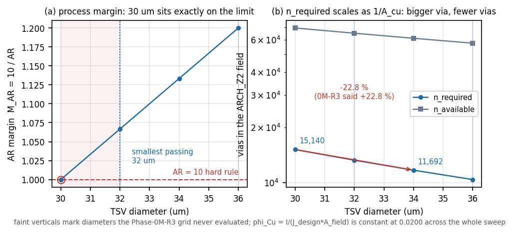

# PHASE 0M-R3A --- FINAL CURRENT-STATE AUDIT

What a reader of the current documents is told, checked against what the framework actually knows. The BEFORE column is measured by re-running the audit against the preserved Phase-0M-R3 reports in `_baseline_phase0mr3/`, not recalled.

| | before (0M-R3 as shipped) | after (0M-R3A) |
|---|---|---|
| stale findings, historical report | 10 | 0 |
| stale findings, standalone audit | 3 | 0 |
| **total** | **13** | **0** |

### What the 13 were

| rule | n | what it caught |
|---|---|---|
| `response_not_damage_life_failure` | 3 | the FE output called damage, or Z2 said to outlive Z1, while the damage law, the life model and the failure criterion are all OPEN |
| `historical_358_not_current` | 2 | the Phase-0I 35.8 % separation presented as the present architecture result. The present repaired pair separates by 16.3 % |
| `via_provenance_precise` | 2 | "the sourced 34 um via" --- no primary source specifies 34 um; only the RANGE is source-backed |
| `single_next_work` | 2 | two already-completed actions listed as future work |
| `gate_count` | 2 | the gate roll behind the phase count |
| `stale_current_state_row` | 2 | a superseded phase asserted as current state in the status table (DEFECT #57) |

The report that carried all thirteen had passed its own audit at **0 findings**. The generators had been advanced; two independent representations of current state existed and only one of them was.

## The zero is negative-tested

A clean audit is evidence only if the guards reject the real sentences. All **10** offending sentences below are VERBATIM from a shipped Phase-0M-R3 document or the generator behind it --- never a paraphrase --- injected into a current-facing section of the present report.

| item | rule | source | sentence | rejected |
|---|---|---|---|---|
| C | `_table_row` | `ETM_DVPD_FULL_TECHNICAL_REPORT.md:3686` | \| phase \| **0M-R2 complete** \| `results/phase0mr2/PHASE0MR2_REALIZABILITY_COOLING_STATE_CL... | **YES** |
| C | `_table_row` | `ETM_DVPD_FULL_TECHNICAL_REPORT.md:3700` | \| component partition status \| **ZERO OF TWELVE REALIZABLE, AT ANY CORNER OF THE BOUNDED CL... | **YES** |
| E | `single_next_work` | `ETM_DVPD_FULL_TECHNICAL_REPORT.md:4276` | acquisition in parallel; (2) ADOPT the Phase-0M physical cooling model into the ETM loop; (3) | **YES** |
| E | `single_next_work` | `ETM_DVPD_FULL_TECHNICAL_REPORT.md:4277` | PUT THE RDL IN THE MECHANICAL MESH, which is the largest unmodelled mechanism that could change | **YES** |
| F | `response_not_damage_life_failure` | `ETM_DVPD_FULL_TECHNICAL_REPORT.md:78` | the backside architecture shows 35.8 % less local damage than embedded | **YES** |
| F | `response_not_damage_life_failure` | `ETM_DVPD_CURRENT_FRAMEWORK_AUDIT_REPORT.md:815` | Z2 accumulates less solder-fatigue damage than Z1 | **YES** |
| F | `response_not_damage_life_failure` | `0M-R3 current_facing wording` | Z2 outlives Z1 at the operating baseline. | **YES** |
| G | `historical_358_not_current` | `ETM_DVPD_FULL_TECHNICAL_REPORT.md:78` | the backside architecture shows 35.8 % less local damage than embedded and the power-die arch... | **YES** |
| O | `via_provenance_precise` | `ETM_DVPD_FULL_TECHNICAL_REPORT.md:133` | close the TSV process margin on ARCH_Z2, either by adopting the sourced 34 um via or by | **YES** |
| P | `gate_count` | `ETM_DVPD_CURRENT_FRAMEWORK_AUDIT_REPORT.md:74` | **Method.** Twenty sequential falsification gates (0B, 0C, 0D, 0D-R, 0E, 0F, 0G, 0H, 0I, 0I-R... | **YES** |

And **3** positive controls: sentences that look like the forbidden ones but are the record working correctly. A guard that rejects a retraction is over-firing --- which is how Phase 0M-R3 silently lost three of five cross-field invariants.

| rule | sentence | correctly left alone |
|---|---|---|
| `via_provenance_precise` | THE WORDING `SOURCED 34 um VIA` IS WITHDRAWN. No primary source specifies 34 um; what is source-backed is t... | **YES** |
| `response_not_damage_life_failure` | No current claim says Z2 outlives Z1; absolute life is not earned. | **YES** |
| `historical_358_not_current` | The historical Phase-0I figure of 35.8 % is NOT the present architecture result. | **YES** |

## The four issues this gate was opened for

| # | issue | finding |
|---|---|---|
| 1 | stale current-state generators survived a "0 findings" audit | **CONFIRMED, DEFECT #57.** Two representations of current state; only `meta`/`verdict` were advanced in 0M-R3. The rendered table said phase = 0M-R2 complete under a heading reading "Current scientific status (Phase 0M-R3)" |
| 2 | current-facing text still calls the FE response "damage" | **CONFIRMED.** Also "outlives", and the historical 35.8 % presented as the current result |
| 3 | the 15 -> 20 um repair may borrow a TSV range | **CONFIRMED, DEFECT #58.** It does. `ls_to_L` is a 673 um intra-converter stacked via; the range governs through-silicon vias, which span 74 um in ARCH_Z1 |
| 4 | "34 um costs 22.8 % more vias" contradicts J*A provisioning | **CONFIRMED, DEFECT #59.** It is 22.8 % FEWER, and a reduction rather than a cost |

## Issue 3 in detail --- the repair is arithmetically right and unsourced

The arithmetic was re-derived by an implementation sharing no code with production:

| r (um) | pitch (um) | n_required | n_available | ratio | production | agrees |
|---|---|---|---|---|---|---|
| 15.0 | 60.0 | 309 | 250 | 1.2360 | 1.2360 | YES |
| 17.5 | 65.0 | 225 | 213 | 1.0563 | 1.0563 | YES |
| 20.0 | 70.0 | 171 | 183 | 0.9344 | 0.9344 | YES |
| 22.5 | 75.0 | 135 | 160 | 0.8438 | 0.8438 | YES |
| 25.0 | 80.0 | 109 | 140 | 0.7786 | 0.7786 | YES |

Exact at every radius. The defect is not in the numbers, it is in the licence: the design space offers `tsv.*` (through-silicon), `rdl.*` (trace width and space, no via) and `bump.*` (bumps), and **none of them governs a stacked via through substrate power layers**. The 20 um radius is a design point in an unsourced process window.

## Issue 4 in detail

| quantity | 30 um | 32 um | 34 um |
|---|---|---|---|
| M_AR | 1.000 | 1.067 | 1.133 |
| passes modest bound | False | True | True |
| n_required | 15140 | 13250 | 11692 |
| n_available | 69440 | 65032 | 61031 |
| phi_Cu | 0.020002 | 0.020003 | 0.020002 |

`n_required = ceil(I / (J_design * A_cu))` scales as `1/A_cu`: 15140 -> 11692, **-22.8 %**. `phi_Cu` is constant to six decimal places across the whole sweep, which is the allocation law doing exactly what it says --- the radius cancels out of the copper fraction, so nothing downstream of it moves. That is why no replay was run.

32 um was never evaluated: the Phase-0M-R3 grid was 30/34/40/50/60. It passes the same modest bound at M_AR = 1.067.

## Current state, as it now stands

| field | value |
|---|---|
| `current_phase` | 0M-R3A complete |
| `current_verdict` | Phase 0M-R3A: Z1/Z2 ORDERING SURVIVES, BUT THE INTRA-VR VIA TECHNOLOGY REMAINS UNSOURCED (option B). A realizable Z1 and Z2 pair exists and the deciding ordering holds at D_driver = 1.1943, but the repair that made them routable sets an intra-converter vertical interconnect to r = 20 um using a range that governs THROUGH-SILICON VIAS, not the package-substrate via this net actually is (DEFECT #58). Package clearan... |
| `current_next_work` | Phase 0N is NOT authorised. Ranked: (1) source a process rule for the INTRA-CONVERTER VERTICAL INTERCONNECT, which DEFECT #58 showed has none and which the routing repair depends on; (2) source the three package clearances; (3) close the ARCH_Z2 TSV process margin, for which 32 um is the smallest diameter on the evaluated grid with positive margin and which costs 12.5 % FEWER vias, not more; (4) high-stress SAC305... |

## Optimizer gate

**FORBIDDEN.** 6 preconditions stand at NO. Phase 0M-R3A DOWNGRADED `routing scope physically correct` from YES to PARTIAL and added `intra-VR via technology sourced` at NO.

| precondition | status | changed this phase |
|---|---|---|
| interconnect geometry and crowding validated | **PARTIAL** |  |
| routing scope physically correct | **PARTIAL** | **yes** |
| cooling boundary tied to physical hardware | **PARTIAL** |  |
| architecture templates realizable | **PARTIAL** |  |
| architecture geometry physically represented | **PARTIAL** |  |
| process margin on the critical interconnect | **NO** | **yes** |
| intra-VR via technology sourced | **NO** | **yes** |
| dominant mechanical physics closed | **NO** |  |
| an admissible mechanical criterion exists | **NO** |  |
| a required life exists | **NO** |  |
| absolute fatigue prediction validated | **NO** |  |

## What this audit does not close

The framework can now say, without contradicting itself, what it knows and what it does not. It cannot yet say that either architecture is buildable. Three package clearances are unsourced, the intra-VR via technology is unsourced, ARCH_Z2's TSV field has no process margin at 30 um, and the SAC305 constitutive response at the stresses that matter is uncharacterised. See `final_open_items.md`.
