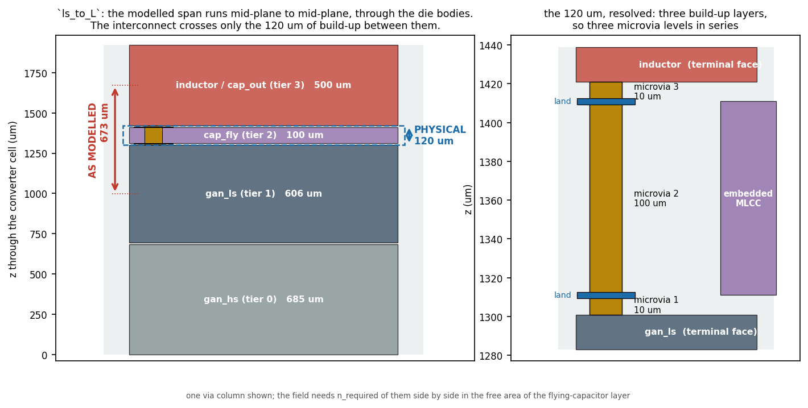

# PHASE 0M-R3B --- WHAT `ls_to_L` PHYSICALLY IS

> **The 673 um span was the artifact, not the technology.**

`build_edges()` addresses every component at its tier MID-PLANE, so the vertical link from the low-side GaN switch to the inductor was measured from the geometric centre of one component to the geometric centre of the other. That line passes through 303 um of GaN die body and 250 um of inductor body. No interconnect does that: components are contacted at their terminal faces.

## The correction

| edge | I_rms | as modelled | physical | overstatement |
|---|---|---|---|---|
| `hs_to_cf` | 1.015 A | 1018.5 um | 626.0 um | **1.63x** |
| `hs_to_ls` | 1.435 A | 655.5 um | 10.0 um | **65.55x** |
| `ls_to_L` | 20.408 A | 673.0 um | 120.0 um | **5.61x** |

The defect is systematic across every vertical edge, not specific to `ls_to_L`. `hs_to_ls` is the extreme case: two dies in adjacent tiers, separated physically by one 10 um RDL, modelled as 655.5 um of copper.

## What the chain actually crosses

| # | layer | thickness | what is in it |
|---|---|---|---|
| 1 | RDL above gan_ls | 10 um | none |
| 2 | flying-capacitor power layer | 100 um | embedded MLCC bodies; the via must route beside them |
| 3 | RDL below inductor | 10 um | none |

**120 um in three build-up layers**, so the interconnect is a chain of three microvia levels in series with a capture land between each pair -- not one via, and not a through-silicon via.

## Why this matters more than the length

`n_required = ceil(I / (J * A_cu))` has no length in it, so the correction does NOT change the via COUNT and the Phase-0M-R3A arithmetic stands. What changes is the resistance, and what the sourcing question is actually about: a 120 um build-up stack is ordinary embedded-component packaging, not an exotic structure, and there is real literature for it.
